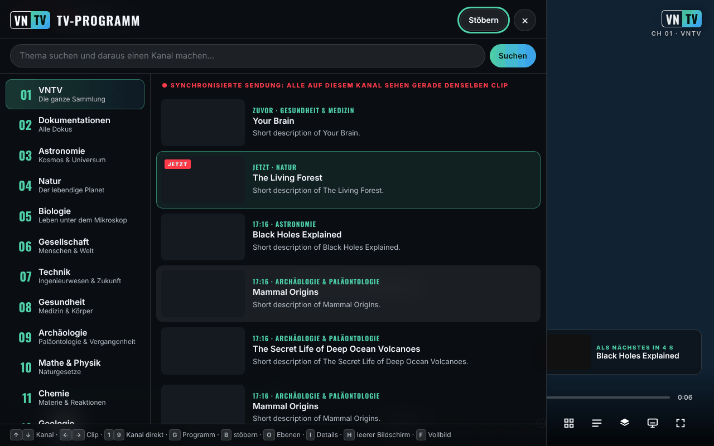

# VNTV — VideoNeat Television

[English](README.md) · [Română](README.ro.md) · [Français](README.fr.md) · [Italiano](README.it.md) · [Español](README.es.md) · [Português](README.pt.md) · **Deutsch** · [Magyar](README.hu.md)

**Version:** 2.5.9 · **Zuletzt aktualisiert:** 2026-10-23

Oberflächensprachen: **Română, English, Français, Italiano, Español, Português (PT), Deutsch, Magyar**

**Online / Demo:** https://chiuta.github.io/VNTV/



*Der Screenshot wurde mit simulierten Testdaten (fiktive Titel, Beispielclip) erstellt, nicht mit dem echten Katalog.*

Ein rund um die Uhr laufender, trade-free (kommerzfreier) Wissenschaftsfernsehkanal, aufgebaut aus der Sammlung von [VideoNeat.com](https://www.videoneat.com):
synchronisierte Kanäle, ein TV-Guide, ein durchsuchbarer Katalog, übersetzte Untertitel, 8 Sprachen, und er funktioniert auf Telefonen,
Tablets, Computern und Fernsehern. Keine Konten, keine Analytics, keine Cookies; standardmäßig kommuniziert die App nur mit den eigenen Websites von TROM (videoneat.com und videos.trom.tf), siehe *Datenschutz und Trade-free* weiter unten.

## Was es ist

VNTV spielt die **Trailer** der Dokumentarfilme der VideoNeat-Sammlung (gehostet von der PeerTube-Instanz von TROM, `videos.trom.tf`) wie einen Fernsehkanal ab: Kanäle nach Kategorien, TV-Guide, Durchsuchen des Katalogs, Untertitel und 8 Oberflächensprachen. Das Projekt hostet kein Video; es zeigt und verweist auf die offizielle Quelle. Auf dem TROM-Kanal und auf den PeerTube-Kanälen, die du selbst hinzufügst, laufen vollständige Videos.

## Inhalt dieses Repositorys

| Ordner | Was es ist |
|---|---|
| `index.html`, `dist/vntv.html` | **Die App als eine Datei.** Öffne sie in einem Browser. Funktioniert auch aus dem Download-Ordner eines Telefons. |
| `deploy/site/` | Die App zum Hosten per HTTPS: installierbar (Startbildschirm / App), funktioniert offline, Icons, Service Worker. |
| `wp-plugin/videoneat-index/` | **WordPress-Plugin für videoneat.com**: veröffentlicht den offiziellen JSON-Katalog, den VNTV und das Addon verwenden. |
| `stremio-addon/` | Stremio-Addon (7 Sprachen, offizieller Katalog, zusätzliche PeerTube-Kanäle, optional LibreTranslate). |
| `src/`, `i18n/` | Quellen. `node build.mjs` erzeugt beide App-Varianten. |
| `tools/` | `coverage.mjs` (wie viele Titel abspielbar sind), `structure-check.mjs` (wöchentliche Prüfung), `make-icons.py`. |
| `tests/` | Automatisierte Tests (Playwright, Offline-Simulationen). `npm test`. |
| `docs/` | Architektur, Bereitstellung, Leitfaden für die TROM-Administratoren, Vorschlagsschreiben an TROM, Checkliste für echte Geräte, Android TV. |

**Dokumentation:** [Bereitstellung](docs/DEPLOY.de.md) · [Android TV](docs/ANDROID-TV.de.md) · [Leitfaden für die TROM-Administratoren](docs/TROM-ADMIN.md) (auf Englisch) · [Architektur](docs/ARCHITECTURE.md) (auf Englisch)

## Funktionen

Im Code überprüft:

- 14 Kanäle nach Kategorien, dazu die **Favoriten** und der Kanal **TROM**; du kannst PeerTube-Kanäle hinzufügen (Einstellungen → Quellen).
- **Synchronisierte Ausstrahlung** (ON AIR): Das Programm wird aus dem Datum berechnet, sodass alle Zuschauer desselben Kanals im selben Moment denselben Clip sehen (sie benötigt den JSON-Katalog mit Laufzeiten; ohne ihn zeigt die App „NON-STOP“, eine eigene Playlist).
- TV-Guide, Durchsuchen der Sammlung mit Suche, Detailblatt, Favoriten, Suche als „Kanal“.
- PeerTube-Untertitel (einschließlich automatischer Transkripte), automatische Übersetzung von Titeln, Beschreibungen und Untertiteln.
- 8 Sprachen: Englisch, Rumänisch, Französisch, Spanisch, Deutsch, Italienisch, Portugiesisch, Ungarisch.
- Anzeigeebenen (Logo, Uhr, Banner, Fortschrittsbalken, „Retro“-Bildschirm usw.) und 4 Voreinstellungen: TV, Kino, Retro, Sauber.
- **P2P**-Wiedergabe (der PeerTube-Player) oder **direkte** Wiedergabe (MP4-Datei); Bild-im-Bild, Senden an den Fernseher, Bildschirm bleibt an, Steuerung vom Sperrbildschirm.
- Kioskmodus für öffentliche Bildschirme: `?kiosk=1&ch=3&lang=en&preset=cinema&muted=0&reload=24`.
- Die gehostete Version kann als App installiert werden und funktioniert für die Oberfläche offline (nicht aber für Video).

## Bedienungsanleitung

1. Öffne die Seite und drücke die Starttaste auf dem Startbildschirm (oder Eingabe/Leertaste).
2. Wechsle den Kanal mit ↑ / ↓ (oder den Ziffern 1–9); nächster / vorheriger Clip mit → / ←; Leertaste oder K pausiert.
3. Drücke **G** für den TV-Guide (Kanäle und nächstes Programm), **B** zum Durchsuchen der Sammlung, **I** für die Details des aktuellen Clips, **O** für Ebenen und Einstellungen, **S** für Favoriten, **F** für Vollbild, **H** für saubere Anzeige, **M** für Ton.
4. Auf dem Telefon verwendest du die Schaltflächen auf dem Bildschirm; berühre den Bildschirm, um die Steuerelemente anzuzeigen.
5. Für eine andere Sprache: Einstellungen (O) → Sprache. Die automatische Übersetzung lässt sich an derselben Stelle abschalten.
6. Für einen PeerTube-Kanal: Einstellungen (O) → Alles anzeigen → Quellen → Kanaladresse einfügen (`https://instanz/c/kanal`) → Hinzufügen.
7. Wenn P2P nicht funktioniert oder deine IP-Adresse für andere Zuschauer nicht sichtbar sein soll: Einstellungen → Netzwerk → **Direkt**.

## Woher VNTV seine Daten bekommt

1. **Offizieller Katalog (bevorzugt):** `https://www.videoneat.com/wp-json/videoneat/v1/index`, veröffentlicht vom
   Plugin `videoneat-index`. Eine kleine zwischengespeicherte Datei: schnell, ohne fehleranfälliges Parsen, und sie enthält die Trailer-Laufzeiten,
   die die **synchronisierte Ausstrahlung** benötigt.
2. **Ausweichlösung:** die öffentliche WordPress-API, die jeden Artikel liest. Langsamer; die App zeigt ehrlich **NON-STOP**
   statt **ON AIR**, weil jeder seine eigene Playlist erhält.
3. **Zusätzliche Quellen:** Jeder PeerTube-Kanal mit offen lizenzierten Videos kann als Kanal hinzugefügt werden (Ebenen → Quellen).

## Wiedergabe

* **P2P** (Standard auf Computern und Fernsehern): der offizielle PeerTube-Player, der die Last unter den Zuschauern verteilt und
  die Serverkosten von TROM senkt. VNTV steuert ihn über die PeerTube-Embed-API.
* **Direkt** (Standard auf iOS und auf Telefonen mit mobilen Daten): die MP4-Datei in einem `<video>`-Element — nötig für
  Bild-im-Bild, AirPlay und Chromecast, und schonender für mobile Daten.
* Vor der ersten Nutzung von P2P erklärt VNTV, dass P2P die IP des Zuschauers für andere Zuschauer sichtbar macht, und bietet
  stattdessen die direkte Wiedergabe an. Reagiert der PeerTube-Player nicht innerhalb von 10 s, wechselt VNTV zur direkten Wiedergabe.

## Kanäle

VideoNeat-Kategorien 1–14 (Trailer) · 15 Favoriten · **16 TROM** (die vollständigen Dokumentarfilme von TROM von videos.trom.tf)
· 17+ jeder PeerTube-Kanal, den der Zuschauer hinzufügt. Kanal 16 lässt sich unter Einstellungen → Quellen entfernen.

## Datenschutz und Trade-free

* **Lokaler Speicher (`localStorage`, nur in deinem Browser):** `vntv.prefs` (Sprache, Kanal, Einstellungen), `vntv.ov` (Ebenen), `vntv.favs` (Favoriten), `vntv.trc` (Übersetzungsspeicher, max. 2500). Keine Cookies, Konten oder Analytics. Ist `localStorage` nicht verfügbar, arbeitet die App mit temporärem Speicher. Im Kioskmodus werden die Einstellungen nicht gespeichert.
* Standardmäßig kontaktierte Hosts: `www.videoneat.com` (Katalog, Bilder; als Ausweichlösung die WordPress-API) und `videos.trom.tf` (Videodaten, Dateien, P2P-Player, Untertitel). Andere Hosts nur, wenn der Zuschauer einen PeerTube-Kanal hinzufügt, eine LibreTranslate-Adresse eingibt oder ausdrücklich MyMemory wählt. Im P2P-Modus verbindet sich der PeerTube-Player auch mit anderen Zuschauern (WebRTC). Wird die App von einem Host wie GitHub Pages ausgeliefert, sieht dieser Host den Besuch wie bei jeder Webseite.
* Die Schriftarten sind eingebettet (Oswald, SIL OFL). Keine Google Fonts, keine Analytics, keine Cookies.
* Übersetzung von Inhalten: der geräteinterne Übersetzer des Browsers oder dein eigenes **LibreTranslate**. Der kommerzielle Dienst
  MyMemory (`api.mymemory.translated.net`) wird **nur verwendet, wenn der Zuschauer ihn ausdrücklich wählt**, mit einem Warnhinweis (die zu übersetzenden Texte werden an ihn gesendet).
* Favoriten, Einstellungen und Übersetzungen bleiben im Browser des Zuschauers.
* **Berechtigungen:** Bildschirm bleibt an (Wake Lock), Vollbild, Bild-im-Bild. Es verlangt weder Kamera noch Mikrofon noch Standort.
* Die Seite enthält eine CSP-Richtlinie (`<meta>`), die das Laden auf HTTPS/HTTP beschränkt und Objekte und Formulare blockiert.

## Grenzen und Warnhinweise

- Die App hängt von der Verfügbarkeit von `videoneat.com` und `videos.trom.tf` ab; ohne sie hat sie nichts abzuspielen.
- Die Trailer gehören ihren Produzenten (PBS, BBC und andere) und werden zur Entdeckung gezeigt, mit einem Link zur offiziellen Quelle. Für die Entfernung von Inhalten: [TROM](https://www.tromsite.com/contact/); was von VideoNeat / videos.trom.tf verschwindet, verschwindet auch aus VNTV. VNTV zeigt keine Torrent-/Magnet-Dateien und verweist nicht darauf.
- Automatische Übersetzungen können falsch sein; du kannst jederzeit das Original sehen.
- Die Screenshots und die automatisierten Tests verwenden simulierte Daten; der Betrieb auf echten Geräten (TV, iOS, Cast) muss gemäß `docs/TESTING.md` überprüft werden.
- Die Verfügbarkeit von P2P, AirPlay und Cast unterscheidet sich je nach Browser und Gerät.

## Changelog (2.3.0)

### 2.5.8 — 2026-10-23
- fff-kit 1.2.0 (Module `store` und `dialog`): Die Bestätigung vor dem Öffnen eines Direktlinks zu einem unbekannten Video-Host verwendet jetzt den barrierefreien Dialog des Kits (`FFF.dialog.confirm`) statt des nativen `confirm`-Fallbacks des Browsers. Die Browser-Schlüssel waren bereits präfixiert (`vntv.*`); eine Datenmigration ist nicht nötig.

### 2.5.6 — 2026-10-22
- Tests: Warten auf Bedingungen statt auf Echtzeit, damit die Suiten unter Last zuverlässig durchlaufen. Das Verhalten der App ändert sich nicht.

### 2.5.5 — 2026-10-22
- fff-kit 1.1.4: Touch-Ziele und Mindestschriftgröße; Touch-Ziele/Text korrigiert

* 2.5.4 — 2026-10-22: fff-kit 1.1.2: PBKDF2 mit 600.000 Iterationen, Schutz vor Clickjacking.
* 2.5.3 — 2026-10-22: das Transparenzlabel listet keinen beschädigten Host (`${it._h`) mehr; die `index.html` im Stammverzeichnis ist jetzt die gehostete Variante mit echtem `sw.js`, Manifest und Icons (Offline funktioniert auf der veröffentlichten Seite); Beschriftungen für die beiden Suchfelder; sichtbarer Tastaturfokus an allen Bedienelementen; Text ≥ 12 px, größere Fußzeilenlinks und keine Überbreite der Steuerleiste bei 360 px; die Bestätigung beim Öffnen eines Links nutzt den Dialog der Seite; wenn der Katalog nicht geladen werden kann, nennt die Meldung jede fehlgeschlagene Quelle (der offizielle Index antwortet auf videoneat.com mit 404/CORS).
* 2.5.2 — 2026-10-22: Die Meldung „Liste kann nicht geladen werden“ auf dem Startbildschirm und die Beschreibung im fff-kit-Transparenzpanel folgen jetzt der Oberflächensprache, wenn diese gewechselt wird.

* 2.3.0 — 2026-10-18: Robustheit bei Wiedergabefehlern — Wiederholung, Ausweichen auf andere Qualität/anderes Format, P2P und alternativer PeerTube-Host, Warten im Offlinezustand, lokale 24-Stunden-Sperrliste, Fehlerleiste mit Aktionen, lokales exportierbares Fehlerprotokoll (keine Telemetrie).

* 2.2.0 — 2026-10-18: neues Panel **Bildschirm** — Cast / AirPlay, Bild-im-Bild, separates Fenster (zweiter Monitor) und ein Kiosk-Link + QR-Code für einen Fernseher oder einen beliebigen anderen Bildschirm.

* 2.1.4 — 2026-10-12: Die Version und das Datum der letzten Aktualisierung werden jetzt in der App angezeigt (Panel Ebenen).
* Startbildschirm: Die Meldung „Liste kann nicht geladen werden“ wird jetzt inline unter dem Einleitungstext angezeigt statt als Toast, der bei 360 px das VNTV-Logo überdeckte; solange der Browser meldet, offline zu sein, wird die Katalogabfrage beim Start nicht mehr versucht (sie wiederholt sich von selbst beim Ereignis `online`).

* CSP: Das Inline-Skript wird jetzt per SHA-256-Hash erlaubt (von `build.mjs` bei jedem Build berechnet); `script-src` enthält kein `'unsafe-inline'` mehr.
* Der Startbildschirm zeigt einen Hinweis (7 Sprachen), wenn der Browser meldet, offline zu sein, da VNTV keine Offline-Inhalte hat.
* Die mitgelieferte Testsuite (Playwright, simuliertes Netzwerk) läuft jetzt in dieser Umgebung: 25/25 bestanden im letzten Durchlauf (beim ersten Durchlauf schlug ein zeitempfindlicher Test, die Synchronisation zwischen zwei Zuschauern, fehl und bestand bei der Wiederholung).
* Das Attribut `allow` des PeerTube-iframes wird nur gesetzt, wenn das iframe verwendet wird (beseitigt drei Konsolenwarnungen beim Start).

* Die App ist jetzt in eine `<main>`-Landmarke eingefasst, und der Titel „Lower Third“ ist keine leere Überschrift mehr (axe-core: 0 Verstöße bei 1280 und 360 px).
* Die Meldung „Liste kann nicht geladen werden“ sagt jetzt klar, dass VNTV keine Offline-Inhalte hat und eine Internetverbindung benötigt (7 Sprachen).
* Version auf 2.1.1 angehoben (package.json, Lockfile, generierter Service Worker).
* Ohne echtes Netzwerk fehlt der Katalog; die Wiedergabe wurde nur mit dem simulierten Netzwerk der Tests überprüft, nicht mit videoneat.com (eine angegebene Grenze).

## Lizenz

MIT, siehe [LICENSE](LICENSE). Eingebettete Schriftart: Oswald, SIL OFL 1.1 (`src/fonts/OFL-Oswald.txt`, Details in [NOTICE.md](NOTICE.md)).

## Build und Tests

```bash
node build.mjs                 # index.html + dist/vntv.html + deploy/site/index.html + sw.js
npm install                    # ESLint + Playwright (dev only)
npx playwright install chromium
npm run test:all               # lint + 25 end-to-end + 30 PHP + 33 addon tests, all offline
```

Öffne `index.html` direkt im Browser (für Katalog und Video wird Internet benötigt). `node build.mjs` erzeugt `index.html`, `dist/vntv.html` und `deploy/site/` und benötigt kein `npm install`. Für die vollständigen Tests: `npm install`, `npm run test:all` (Playwright, PHP und Node; alle laufen mit simulierten Daten).

Veröffentlichung auf GitHub Pages: `Settings → Pages → Source: GitHub Actions`; der Workflow `.github/workflows/pages.yml` baut und veröffentlicht `deploy/site` (plus `vntv.html` als Download).

## Kiosk / öffentliche Bildschirme

`vntv.html?kiosk=1&ch=3&lang=en&preset=cinema&muted=0&reload=24` — startet von selbst, ohne Steuerelemente, ohne Mauszeiger,
lädt täglich neu. Drücke dreimal **K**, um zu beenden.

## Autor

Alexio — Alexandru-Ionuț Chiuță, Kontakt: alexio@trom.tf

---
Siehe [CHANGELOG.md](CHANGELOG.md).
