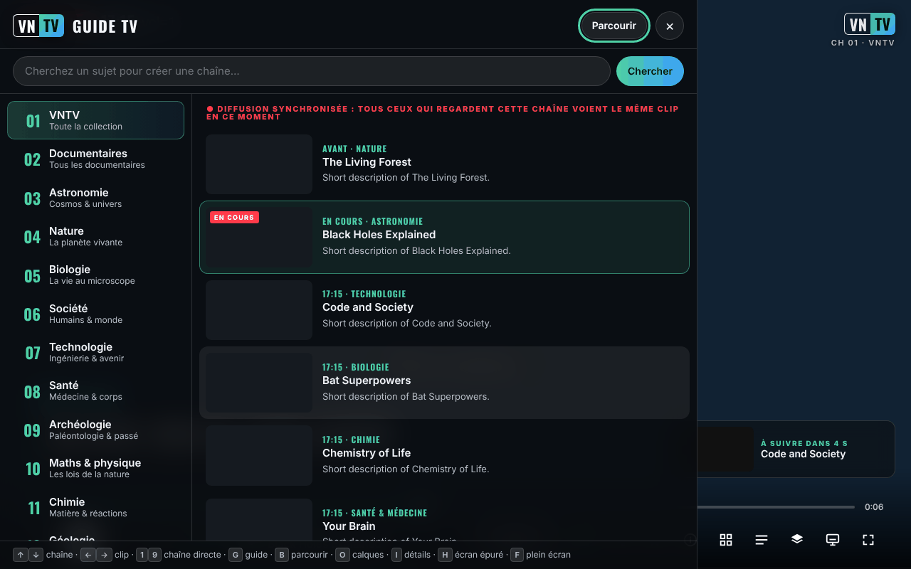

# VNTV — VideoNeat Television

[English](README.md) · [Română](README.ro.md) · **Français** · [Italiano](README.it.md) · [Español](README.es.md) · [Português](README.pt.md) · [Deutsch](README.de.md) · [Magyar](README.hu.md)

**Version :** 3.0.0 · **Dernière mise à jour :** 2026-10-26

Langues de l'interface : **Română, English, Français, Italiano, Español, Português (PT), Deutsch, Magyar**

**En ligne / démo :** https://chiuta.github.io/VNTV/



*La capture a été réalisée avec des données de test simulées (titres fictifs, clip d'essai), et non avec le catalogue réel.*

Une chaîne TV scientifique non-stop et libre de tout commerce (trade-free), construite à partir de la collection [VideoNeat.com](https://www.videoneat.com) :
chaînes synchronisées, guide TV, catalogue navigable, sous-titres traduits, 8 langues, et elle fonctionne sur téléphones,
tablettes, ordinateurs et téléviseurs. Ni comptes, ni analytique, ni cookies ; par défaut, l'application ne contacte que les sites propres de TROM (videoneat.com et videos.trom.tf), voir *Confidentialité et trade-free* plus bas.

## Qu'est-ce que c'est

VNTV diffuse les **bandes-annonces** des documentaires de la collection VideoNeat (hébergées par l'instance PeerTube de TROM, `videos.trom.tf`) comme une chaîne de télévision : chaînes par catégories, guide TV, navigation dans le catalogue, sous-titres et 8 langues d'interface. Le projet n'héberge pas de vidéo ; il montre et renvoie vers la source officielle. Les vidéos complètes sont lues sur la chaîne TROM et sur les chaînes PeerTube que vous ajoutez vous-même.

## Contenu de ce dépôt

| Dossier | De quoi s'agit-il |
|---|---|
| `index.html`, `dist/vntv.html` | **L'application en un seul fichier.** Ouvrez-la dans un navigateur. Fonctionne aussi depuis le dossier Téléchargements d'un téléphone. |
| `deploy/site/` | L'application à héberger en HTTPS : installable (écran d'accueil / application), fonctionne hors ligne, icônes, service worker. |
| `wp-plugin/videoneat-index/` | **Plugin WordPress pour videoneat.com** : publie le catalogue JSON officiel utilisé par VNTV et par l'addon. |
| `stremio-addon/` | Addon Stremio (7 langues, catalogue officiel, chaînes PeerTube supplémentaires, LibreTranslate facultatif). |
| `src/`, `i18n/` | Sources. `node build.mjs` produit les deux variantes de l'application. |
| `tools/` | `coverage.mjs` (combien de titres sont lisibles), `structure-check.mjs` (vérification hebdomadaire), `make-icons.py`. |
| `tests/` | Tests automatisés (Playwright, simulations hors ligne). `npm test`. |
| `docs/` | Architecture, déploiement, guide des administrateurs TROM, lettre de proposition à TROM, liste de contrôle sur appareils réels, Android TV. |

**Documentation:** [Déploiement](docs/DEPLOY.fr.md) · [Android TV](docs/ANDROID-TV.fr.md) · [Guide des administrateurs TROM](docs/TROM-ADMIN.md) (en anglais) · [Architecture](docs/ARCHITECTURE.md) (en anglais)

## Fonctions

Vérifiées dans le code :

- **Ma bibliothèque (touche W) :** historique local avec cartes de reprise, listes personnelles (M3U/JSON), abonnements à des listes PeerTube publiques et vérification automatique des liens.
- 14 chaînes par catégories, plus les **Favoris** et la chaîne **TROM** ; vous pouvez ajouter des chaînes PeerTube (Réglages → Sources).
- **Diffusion synchronisée** (ON AIR) : la programmation est calculée à partir de la date, de sorte que tous les spectateurs d'une même chaîne voient le même clip au même moment (elle exige le catalogue JSON avec les durées ; sans lui, l'application affiche « NON-STOP », sa propre liste de lecture).
- Guide TV, navigation dans la collection avec recherche, fiche de détails, favoris, recherche comme « chaîne ».
- Sous-titres PeerTube (y compris les transcriptions automatiques), traduction automatique des titres, des descriptions et des sous-titres.
- 8 langues : anglais, roumain, français, espagnol, allemand, italien, portugais, hongrois.
- Couches d'affichage (logo, horloge, bandeau, barre de progression, écran « rétro », etc.) et 4 préréglages : TV, Cinéma, Rétro, Épuré.
- Lecture **P2P** (le lecteur PeerTube) ou **directe** (fichier MP4) ; image dans l'image, envoi vers un téléviseur, écran maintenu allumé, commandes depuis l'écran de verrouillage.
- Mode kiosque pour écrans publics : `?kiosk=1&ch=3&lang=en&preset=cinema&muted=0&reload=24`.
- La version hébergée peut être installée comme application et fonctionne hors ligne pour l'interface (mais pas pour la vidéo).

## Mode d'emploi

1. Ouvrez la page et appuyez sur le bouton de démarrage de l'écran d'accueil (ou Entrée/Espace).
2. Changez de chaîne avec ↑ / ↓ (ou les chiffres 1–9) ; clip suivant / précédent avec → / ← ; Espace ou K met en pause.
3. Appuyez sur **G** pour le guide TV (chaînes et programme suivant), **B** pour parcourir la collection, **I** pour les détails du clip en cours, **O** pour les couches et les réglages, **S** pour les favoris, **F** pour le plein écran, **H** pour l'écran épuré, **M** pour le son.
4. Sur téléphone, utilisez les boutons à l'écran ; touchez l'écran pour afficher les commandes.
5. Pour une autre langue : Réglages (O) → Langue. La traduction automatique peut être désactivée au même endroit.
6. Pour une chaîne PeerTube : Réglages (O) → Tout afficher → Sources → collez l'adresse de la chaîne (`https://instance/c/chaîne`) → Ajouter.
7. Si le P2P ne fonctionne pas ou si vous ne voulez pas que votre adresse IP soit visible par d'autres spectateurs : Réglages → Réseau → **Direct**.

## D'où VNTV tire ses données

1. **Catalogue officiel (préféré) :** `https://www.videoneat.com/wp-json/videoneat/v1/index`, publié par le
   plugin `videoneat-index`. Un seul petit fichier en cache : rapide, sans analyse fragile, et il porte les durées des bandes-annonces,
   dont a besoin la **diffusion synchronisée**.
2. **Secours :** l'API publique de WordPress, en lisant chaque article. Plus lent ; l'application affiche honnêtement **NON-STOP**
   au lieu de **ON AIR**, car chacun reçoit sa propre liste de lecture.
3. **Sources supplémentaires :** toute chaîne PeerTube proposant des vidéos sous licence ouverte peut être ajoutée comme chaîne (Couches → Sources).

## Lecture

* **P2P** (par défaut sur ordinateurs et téléviseurs) : le lecteur PeerTube officiel, qui répartit la charge entre les spectateurs et
  réduit les coûts de serveur de TROM. VNTV le pilote via l'API d'intégration PeerTube.
* **Directe** (par défaut sur iOS et sur les téléphones utilisant les données mobiles) : le fichier MP4 dans un élément `<video>` — nécessaire pour
  l'image dans l'image, AirPlay et Chromecast, et plus léger pour les données mobiles.
* Avant la première utilisation du P2P, VNTV explique que le P2P rend l'adresse IP du spectateur visible par les autres spectateurs et propose
  la lecture directe à la place. Si le lecteur PeerTube ne répond pas en 10 s, VNTV passe à la lecture directe.

## Chaînes

Catégories VideoNeat 1–14 (bandes-annonces) · 15 Favoris · **16 TROM** (les documentaires complets de TROM sur videos.trom.tf)
· 17+ toute chaîne PeerTube ajoutée par le spectateur. La chaîne 16 peut être retirée dans Réglages → Sources.

## Confidentialité et trade-free

* **Stockage local (`localStorage`, uniquement dans votre navigateur) :** `vntv.prefs` (langue, chaîne, réglages), `vntv.ov` (couches), `vntv.favs` (favoris), `vntv.trc` (mémoire des traductions, 2500 max.). Ni cookies, ni comptes, ni analytique. Si `localStorage` n'est pas disponible, l'application fonctionne avec une mémoire temporaire. En mode kiosque, les réglages ne sont pas enregistrés.
* Hôtes contactés par défaut : `www.videoneat.com` (catalogue, images ; en secours, l'API WordPress) et `videos.trom.tf` (données vidéo, fichiers, lecteur P2P, sous-titres). D'autres hôtes seulement lorsque le spectateur ajoute une chaîne PeerTube, saisit une adresse LibreTranslate ou choisit explicitement MyMemory. En mode P2P, le lecteur PeerTube se connecte aussi à d'autres spectateurs (WebRTC). Lorsque l'application est servie par un hébergeur tel que GitHub Pages, celui-ci voit la visite comme pour n'importe quelle page web.
* Les polices sont intégrées (Oswald, SIL OFL). Ni Google Fonts, ni analytique, ni cookies.
* Traduction du contenu : le traducteur local du navigateur, ou votre propre **LibreTranslate**. Le service commercial
  MyMemory (`api.mymemory.translated.net`) n'est utilisé **que si le spectateur le choisit explicitement**, avec un avertissement (les textes à traduire lui sont envoyés).
* Les favoris, les réglages et les traductions restent dans le navigateur du spectateur.
* **Autorisations :** écran maintenu allumé (wake lock), plein écran, image dans l'image. Ne demande ni caméra, ni microphone, ni position.
* La page contient une politique CSP (`<meta>`) qui limite les chargements à HTTPS/HTTP et bloque les objets et les formulaires.

## Limites et avertissements

- L'application dépend de la disponibilité de `videoneat.com` et de `videos.trom.tf` ; sans eux, elle n'a rien à lire.
- Les bandes-annonces appartiennent à leurs producteurs (PBS, BBC et d'autres) et sont présentées pour la découverte, avec un lien vers la source officielle. Pour un retrait de contenu : [TROM](https://www.tromsite.com/contact/) ; ce qui disparaît de VideoNeat / videos.trom.tf disparaît aussi de VNTV. VNTV ne montre pas de fichiers torrent/magnet et n'y renvoie pas.
- Les traductions automatiques peuvent être erronées ; vous pouvez toujours voir l'original.
- Les captures d'écran et les tests automatisés utilisent des données simulées ; le fonctionnement sur appareils réels (TV, iOS, Cast) doit être vérifié selon `docs/TESTING.md`.
- La disponibilité du P2P, d'AirPlay et de Cast diffère selon les navigateurs et les appareils.

## Changelog (2.3.0)

### 2.5.8 — 2026-10-23
- fff-kit 1.2.0 (modules `store` et `dialog`) : la confirmation affichée avant d'ouvrir un lien direct vers un hôte vidéo inconnu utilise désormais le dialogue accessible du kit (`FFF.dialog.confirm`) au lieu du repli `confirm` natif du navigateur. Les clés du navigateur étaient déjà préfixées (`vntv.*`) : aucune migration de données n'est nécessaire.

### 2.5.6 — 2026-10-22
- Tests : attentes sur des conditions au lieu du temps réel, donc les suites passent de façon stable sous charge. Aucun changement du comportement de l’application.

### 2.5.5 — 2026-10-22
- fff-kit 1.1.4 : cibles tactiles et taille de texte minimale; cibles tactiles/texte corrigés

* 2.5.4 — 2026-10-22 : fff-kit 1.1.2 : PBKDF2 à 600 000 itérations, protection anti-clickjacking.
* 2.5.3 — 2026-10-22 : l'étiquette de transparence ne liste plus d'hôte corrompu (`${it._h`) ; l'`index.html` racine est désormais la version hébergée avec un vrai `sw.js`, un manifeste et des icônes (le hors-ligne fonctionne sur la page publiée) ; libellés des deux champs de recherche ; focus clavier visible sur tous les contrôles ; texte ≥ 12 px, liens du pied plus grands et barre de commandes sans débordement à 360 px ; la confirmation d'ouverture de lien utilise la boîte de dialogue de la page ; si le catalogue ne se charge pas, le message nomme chaque source en échec (l'index officiel répond 404/CORS sur videoneat.com).
* 2.5.2 — 2026-10-22 : le message « impossible de charger la liste » de l'écran d'accueil et la description du panneau de transparence fff-kit suivent désormais la langue de l'interface lorsqu'on la change.

* 2.3.0 — 2026-10-18 : résilience aux erreurs de lecture — nouvelle tentative, repli de qualité/format, P2P et autre hôte PeerTube, attente hors ligne, liste noire locale de 24 h, barre d'erreur avec actions, journal d'erreurs local exportable (sans télémétrie).

* 2.2.0 — 2026-10-18 : nouveau panneau **Écran** — Cast / AirPlay, image dans l'image, fenêtre séparée (deuxième moniteur) et lien kiosque + code QR pour un téléviseur ou tout autre écran.

* 2.1.4 — 2026-10-12 : la version et la date de dernière mise à jour sont désormais affichées dans l'application (panneau Couches).
* Écran d'accueil : le message « impossible de charger la liste » s'affiche désormais en ligne sous le texte d'introduction, au lieu d'une notification qui recouvrait le logo VNTV à 360 px ; tant que le navigateur signale qu'il est hors ligne, la requête vers le catalogue n'est plus tentée au démarrage (elle se relance d'elle-même à l'événement `online`).

* CSP : le script en ligne est désormais autorisé par hachage SHA-256 (calculé par `build.mjs` à chaque build) ; `script-src` ne contient plus `'unsafe-inline'`.
* L'écran d'accueil affiche une note (7 langues) lorsque le navigateur signale qu'il est hors ligne, puisque VNTV n'a pas de contenu hors ligne.
* La suite de tests fournie (Playwright, réseau simulé) a pu être exécutée dans cet environnement : 25/25 réussis à l'exécution finale (à la première exécution, un test sensible au temps, la synchronisation entre deux spectateurs, a échoué puis réussi à la reprise).
* L'attribut `allow` de l'iframe PeerTube n'est défini que lorsque l'iframe est utilisée (supprime trois avertissements de la console au démarrage).

* L'application est désormais encadrée par un repère `<main>` et le titre « lower third » n'est plus un titre vide (axe-core : 0 violation à 1280 et 360 px).
* Le message « impossible de charger la liste » précise désormais clairement que VNTV n'a pas de contenu hors ligne et qu'il faut une connexion internet (7 langues).
* Version portée à 2.1.1 (package.json, lockfile, service worker généré).
* Sans réseau réel, le catalogue est absent ; la lecture n'a été vérifiée qu'avec le réseau simulé des tests, et non avec videoneat.com (limite déclarée).

## Licence

MIT, voir [LICENSE](LICENSE). Police intégrée : Oswald, SIL OFL 1.1 (`src/fonts/OFL-Oswald.txt`, détails dans [NOTICE.md](NOTICE.md)).

## Compilation et tests

```bash
node build.mjs                 # index.html + dist/vntv.html + deploy/site/index.html + sw.js
npm install                    # ESLint + Playwright (dev only)
npx playwright install chromium
npm run test:all               # lint + 25 end-to-end + 30 PHP + 33 addon tests, all offline
```

Ouvrez `index.html` directement dans le navigateur (internet est nécessaire pour le catalogue et la vidéo). `node build.mjs` génère `index.html`, `dist/vntv.html` et `deploy/site/` et n'exige pas `npm install`. Pour les tests complets : `npm install`, `npm run test:all` (Playwright, PHP et Node ; tous s'exécutent avec des données simulées).

Publication sur GitHub Pages : `Settings → Pages → Source: GitHub Actions` ; le workflow `.github/workflows/pages.yml` construit et publie `deploy/site` (ainsi que `vntv.html` en téléchargement).

## Kiosque / écrans publics

`vntv.html?kiosk=1&ch=3&lang=en&preset=cinema&muted=0&reload=24` — démarre toute seule, sans commandes, sans curseur,
se recharge chaque jour. Appuyez trois fois sur **K** pour quitter.

## Auteur

Alexio — Alexandru-Ionuț Chiuță, contact : alexio@trom.tf

---
Voir [CHANGELOG.md](CHANGELOG.md).
