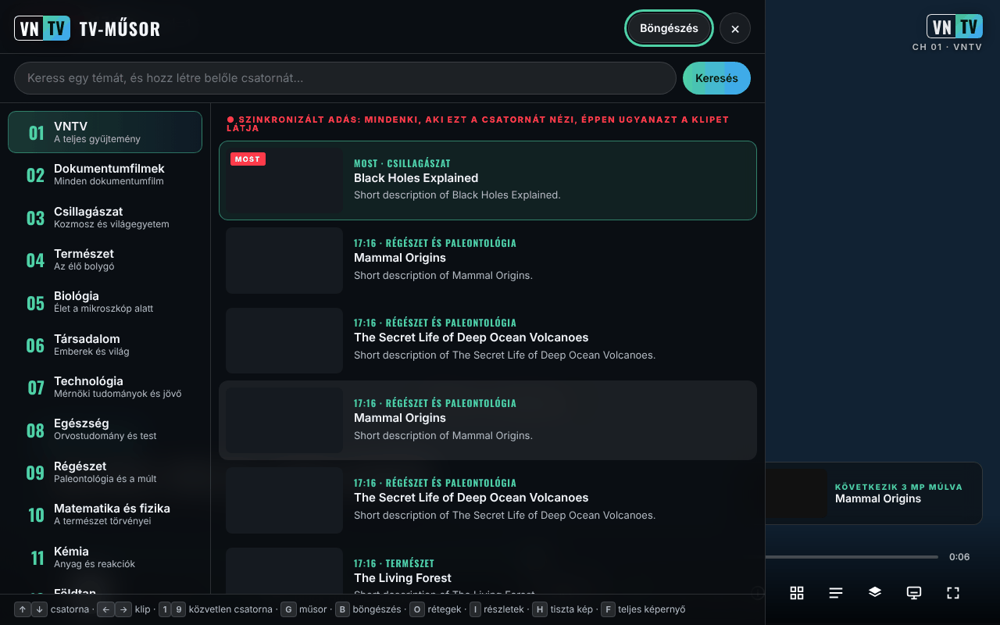

# VNTV — VideoNeat Television

[English](README.md) · [Română](README.ro.md) · [Français](README.fr.md) · [Italiano](README.it.md) · [Español](README.es.md) · [Português](README.pt.md) · [Deutsch](README.de.md) · **Magyar**

**Verzió:** 2.5.1 · **Utolsó frissítés:** 2026-10-19

A felület nyelvei: **Română, English, Français, Italiano, Español, Português (PT), Deutsch, Magyar**

**Online / bemutató:** https://chiuta.github.io/VNTV/



*A képernyőkép szimulált tesztadatokkal (kitalált címekkel, próbaklippel) készült, nem a valódi katalógussal.*

Megszakítás nélkül sugárzó, trade-free (kereskedelemmentes) tudományos TV-csatorna, amely a [VideoNeat.com](https://www.videoneat.com) gyűjteményéből épül:
szinkronizált csatornák, TV-műsorfüzet, böngészhető katalógus, lefordított feliratok, 8 nyelv, és működik telefonon,
táblagépen, számítógépen és tévén. Nincsenek fiókok, analitika és sütik; az alkalmazás alapértelmezés szerint csak a TROM saját oldalaival (videoneat.com és videos.trom.tf) kommunikál, lásd alább az *Adatvédelem és trade-free* szakaszt.

## Mi ez

A VNTV a VideoNeat gyűjtemény dokumentumfilmjeinek **előzeteseit** (a TROM PeerTube-példányán, a `videos.trom.tf` címen tárolva) játssza le televíziós csatornaként: kategóriák szerinti csatornák, TV-műsorfüzet, katalógusböngészés, feliratok és 8 felületi nyelv. A projekt nem tárol videót; megmutatja és a hivatalos forrásra irányít. A TROM csatornán és az általad hozzáadott PeerTube-csatornákon teljes videók játszódnak le.

## Mi van ebben a tárolóban

| Mappa | Mi ez |
|---|---|
| `index.html`, `dist/vntv.html` | **Az alkalmazás egyetlen fájlként.** Nyisd meg egy böngészőben. Egy telefon Letöltések mappájából is működik. |
| `deploy/site/` | A HTTPS-en üzemeltethető alkalmazás: telepíthető (kezdőképernyő / alkalmazás), offline működik, ikonok, service worker. |
| `wp-plugin/videoneat-index/` | **WordPress-bővítmény a videoneat.com számára**: közzéteszi a VNTV és a kiegészítő által használt hivatalos JSON-katalógust. |
| `stremio-addon/` | Stremio-kiegészítő (7 nyelv, hivatalos katalógus, további PeerTube-csatornák, opcionális LibreTranslate). |
| `src/`, `i18n/` | Források. A `node build.mjs` az alkalmazás mindkét változatát előállítja. |
| `tools/` | `coverage.mjs` (hány cím játszható le), `structure-check.mjs` (heti ellenőrzés), `make-icons.py`. |
| `tests/` | Automatizált tesztek (Playwright, offline szimulációk). `npm test`. |
| `docs/` | Architektúra, üzemeltetés, útmutató a TROM adminisztrátorainak, javaslatlevél a TROM-nak, ellenőrzőlista valódi eszközökhöz, Android TV. |

**Dokumentáció:** [Üzemeltetés](docs/DEPLOY.hu.md) · [Android TV](docs/ANDROID-TV.hu.md) · [Útmutató a TROM adminisztrátorainak](docs/TROM-ADMIN.md) (angolul) · [Architektúra](docs/ARCHITECTURE.md) (angolul)

## Funkciók

A kódban ellenőrizve:

- 14 kategóriák szerinti csatorna, valamint a **Kedvencek** és a **TROM** csatorna; PeerTube-csatornákat is hozzáadhatsz (Beállítások → Források).
- **Szinkronizált adás** (ON AIR): a műsorrend a dátumból számítódik, így ugyanazon csatorna összes nézője ugyanabban a pillanatban ugyanazt a klipet látja (a időtartamokat tartalmazó JSON-katalógus szükséges hozzá; nélküle az alkalmazás a „NON-STOP” feliratot mutatja, saját lejátszási listával).
- TV-műsorfüzet, a gyűjtemény böngészése kereséssel, részletlap, kedvencek, a keresés mint „csatorna”.
- PeerTube-feliratok (az automatikus átiratokat is beleértve), a címek, leírások és feliratok automatikus fordítása.
- 8 nyelv: angol, román, francia, spanyol, német, olasz, portugál, magyar.
- Megjelenítési rétegek (logó, óra, szalag, folyamatjelző, „retro” képernyő stb.) és 4 előbeállítás: TV, Mozi, Retro, Tiszta.
- **P2P** lejátszás (a PeerTube-lejátszó) vagy **közvetlen** lejátszás (MP4-fájl); kép a képben, küldés a tévére, bekapcsolva tartott képernyő, vezérlők a zárolási képernyőről.
- Kioszk mód nyilvános képernyőkhöz: `?kiosk=1&ch=3&lang=en&preset=cinema&muted=0&reload=24`.
- A hosztolt változat alkalmazásként telepíthető, és a felület szempontjából offline is működik (a videó szempontjából nem).

## Használati útmutató

1. Nyisd meg az oldalt, és nyomd meg a kezdőképernyő indítógombját (vagy az Entert/Szóközt).
2. Csatornát a ↑ / ↓ billentyűvel (vagy az 1–9 számjegyekkel) válthatsz; következő / előző klip a → / ← billentyűvel; a Szóköz vagy a K szünetet tart.
3. Nyomd meg a **G** billentyűt a TV-műsorfüzethez (csatornák és következő műsor), a **B**-t a gyűjtemény böngészéséhez, az **I**-t az aktuális klip részleteihez, az **O**-t a rétegekhez és beállításokhoz, az **S**-t a kedvencekhez, az **F**-et a teljes képernyőhöz, a **H**-t a tiszta képernyőhöz, az **M**-et a hanghoz.
4. Telefonon a képernyőn lévő gombokat használod; érintsd meg a képernyőt a vezérlők megjelenítéséhez.
5. Másik nyelvhez: Beállítások (O) → Nyelv. Az automatikus fordítás ugyanott kapcsolható ki.
6. PeerTube-csatornához: Beállítások (O) → Minden megjelenítése → Források → illeszd be a csatorna címét (`https://példány/c/csatorna`) → Hozzáadás.
7. Ha a P2P nem működik, vagy nem szeretnéd, hogy az IP-címed látható legyen más nézők számára: Beállítások → Hálózat → **Közvetlen**.

## Honnan szerzi a VNTV az adatait

1. **Hivatalos katalógus (előnyben részesítve):** `https://www.videoneat.com/wp-json/videoneat/v1/index`, amelyet a
   `videoneat-index` bővítmény tesz közzé. Egyetlen kis gyorsítótárazott fájl: gyors, nincs törékeny elemzés, és tartalmazza az előzetesek időtartamát,
   amelyre a **szinkronizált adásnak** szüksége van.
2. **Tartalék:** a nyilvános WordPress API, minden cikket beolvasva. Lassabb; az alkalmazás őszintén a **NON-STOP**
   feliratot mutatja az **ON AIR** helyett, mert mindenki a saját lejátszási listáját kapja.
3. **További források:** bármely, nyíltan licencelt videókat tartalmazó PeerTube-csatorna hozzáadható csatornaként (Rétegek → Források).

## Lejátszás

* **P2P** (alapértelmezett számítógépen és tévén): a hivatalos PeerTube-lejátszó, amely megosztja a terhelést a nézők között, és
  csökkenti a TROM szerverköltségeit. A VNTV a PeerTube beágyazási API-ján keresztül vezérli.
* **Közvetlen** (alapértelmezett iOS-en és mobiladatot használó telefonokon): az MP4-fájl egy `<video>` elemben — szükséges a
  kép a képben, az AirPlay és a Chromecast használatához, és kíméletesebb a mobiladathoz.
* A P2P első használata előtt a VNTV elmagyarázza, hogy a P2P láthatóvá teszi a néző IP-címét más nézők számára, és
  helyette a közvetlen lejátszást ajánlja. Ha a PeerTube-lejátszó 10 mp-en belül nem válaszol, a VNTV közvetlen lejátszásra vált.

## Csatornák

1–14 VideoNeat-kategóriák (előzetesek) · 15 Kedvencek · **16 TROM** (a TROM saját teljes dokumentumfilmjei a videos.trom.tf oldalról)
· 17+ bármely, a néző által hozzáadott PeerTube-csatorna. A 16. csatorna a Beállítások → Források alatt eltávolítható.

## Adatvédelem és trade-free

* **Helyi tárolás (`localStorage`, csak a böngésződben):** `vntv.prefs` (nyelv, csatorna, beállítások), `vntv.ov` (rétegek), `vntv.favs` (kedvencek), `vntv.trc` (fordítási memória, legfeljebb 2500). Nincsenek sütik, fiókok vagy analitika. Ha a `localStorage` nem érhető el, az alkalmazás ideiglenes memóriával működik. Kioszk módban a beállítások nem mentődnek.
* Alapértelmezés szerint felvett kapcsolatok: `www.videoneat.com` (katalógus, képek; tartalékként a WordPress API) és `videos.trom.tf` (videoadatok, fájlok, P2P-lejátszó, feliratok). Más gazdagépekkel csak akkor, ha a néző PeerTube-csatornát ad hozzá, LibreTranslate-címet ad meg, vagy kifejezetten a MyMemory szolgáltatást választja. P2P módban a PeerTube-lejátszó más nézőkhöz is csatlakozik (WebRTC). Ha az alkalmazást egy olyan gazdagép szolgálja ki, mint a GitHub Pages, az a gazdagép a látogatást úgy látja, mint bármely weboldalét.
* A betűtípusok be vannak ágyazva (Oswald, SIL OFL). Nincs Google Fonts, analitika és süti.
* A tartalom fordítása: a böngésző eszközön futó fordítója, vagy a saját **LibreTranslate** példányod. A kereskedelmi
  MyMemory szolgáltatás (`api.mymemory.translated.net`) **csak akkor használatos, ha a néző kifejezetten azt választja**, figyelmeztetéssel (a lefordítandó szövegeket elküldik neki).
* A kedvencek, a beállítások és a fordítások a néző böngészőjében maradnak.
* **Engedélyek:** bekapcsolva tartott képernyő (wake lock), teljes képernyő, kép a képben. Nem kér kamerát, mikrofont vagy helyadatot.
* Az oldal tartalmaz egy CSP-szabályzatot (`<meta>`), amely a betöltéseket HTTPS/HTTP-re korlátozza, és blokkolja az objektumokat és az űrlapokat.

## Korlátok és figyelmeztetések

- Az alkalmazás a `videoneat.com` és a `videos.trom.tf` elérhetőségétől függ; ezek nélkül nincs mit lejátszania.
- Az előzetesek a gyártóké (PBS, BBC és mások), és felfedezési céllal jelennek meg, a hivatalos forrásra mutató hivatkozással. Tartalom eltávolításához: [TROM](https://www.tromsite.com/contact/); ami eltűnik a VideoNeat / videos.trom.tf oldalról, az a VNTV-ből is eltűnik. A VNTV nem mutat torrent-/magnetfájlokat, és nem is hivatkozik rájuk.
- Az automatikus fordítások tévedhetnek; az eredetit bármikor megtekintheted.
- A képernyőképek és az automatizált tesztek szimulált adatokat használnak; a valódi eszközökön (TV, iOS, Cast) való működést a `docs/TESTING.md` szerint kell ellenőrizni.
- A P2P, az AirPlay és a Cast elérhetősége böngészőnként és eszközönként eltér.

## Changelog (2.3.0)

* 2.3.0 — 2026-10-18: ellenállóság a lejátszási hibákkal szemben — újrapróbálkozás, minőségi/formátum-tartalék, P2P és másik PeerTube-gazdagép, offline várakozás, 24 órás helyi tiltólista, hibasáv műveletekkel, helyi, exportálható hibanapló (telemetria nélkül).

* 2.2.0 — 2026-10-18: új **Képernyő** panel — Cast / AirPlay, kép a képben, különálló ablak (második monitor), valamint kioszk-hivatkozás + QR-kód tévéhez vagy bármely más képernyőhöz.

* 2.1.4 — 2026-10-12: a verzió és az utolsó frissítés dátuma mostantól megjelenik az alkalmazásban (Rétegek panel).
* Kezdőképernyő: a „nem sikerült betölteni a listát” üzenet most a bevezető szöveg alatt, beágyazva jelenik meg, az 360 px szélességnél a VNTV-logóra rácsúszó értesítés helyett; amíg a böngésző offline állapotot jelez, a katalóguskérés induláskor már nem kerül megkísérlésre (az `online` eseményre magától újrapróbálja).

* CSP: a beágyazott szkript mostantól SHA-256 hash alapján engedélyezett (a `build.mjs` számítja ki minden buildkor); a `script-src` már nem tartalmaz `'unsafe-inline'` értéket.
* A kezdőképernyő értesítést mutat (7 nyelven), ha a böngésző offline állapotot jelez, mivel a VNTV-nek nincs offline tartalma.
* A mellékelt tesztcsomag (Playwright, szimulált hálózat) mostantól fut ebben a környezetben: a végső futtatáskor 25/25 sikeres (az első futtatáskor egy időérzékeny teszt, a két néző közötti szinkronizáció, megbukott, ismétléskor lefutott).
* A PeerTube iframe `allow` attribútuma csak akkor kerül beállításra, ha az iframe használatban van (megszüntet három konzolfigyelmeztetést induláskor).

* Az alkalmazás mostantól `<main>` landmarkba van foglalva, és az alsó harmad (lower third) címe már nem üres címsor (axe-core: 0 hiba 1280 és 360 px szélességnél).
* A „nem sikerült betölteni a listát” üzenet most egyértelműen kimondja, hogy a VNTV-nek nincs offline tartalma, és internetkapcsolatra van szüksége (7 nyelven).
* A verzió 2.1.1-re emelve (package.json, lockfile, generált service worker).
* Valódi hálózat nélkül a katalógus hiányzik; a lejátszást csak a tesztek szimulált hálózatával ellenőriztük, nem a videoneat.com oldallal (megadott korlát).

## Licenc

MIT, lásd [LICENSE](LICENSE). Beágyazott betűtípus: Oswald, SIL OFL 1.1 (`src/fonts/OFL-Oswald.txt`, részletek a [NOTICE.md](NOTICE.md) fájlban).

## Összeállítás és tesztelés

```bash
node build.mjs                 # index.html + dist/vntv.html + deploy/site/index.html + sw.js
npm install                    # ESLint + Playwright (dev only)
npx playwright install chromium
npm run test:all               # lint + 25 end-to-end + 30 PHP + 33 addon tests, all offline
```

Nyisd meg az `index.html` fájlt közvetlenül a böngészőben (a katalógushoz és a videóhoz internet szükséges). A `node build.mjs` előállítja az `index.html`, a `dist/vntv.html` és a `deploy/site/` fájlokat, és nem igényel `npm install` parancsot. A teljes tesztekhez: `npm install`, `npm run test:all` (Playwright, PHP és Node; mind szimulált adatokkal fut).

Közzététel a GitHub Pages-en: `Settings → Pages → Source: GitHub Actions`; a `.github/workflows/pages.yml` workflow felépíti és közzéteszi a `deploy/site` mappát (valamint a `vntv.html` fájlt letölthetőként).

## Kioszk / nyilvános képernyők

`vntv.html?kiosk=1&ch=3&lang=en&preset=cinema&muted=0&reload=24` — magától elindul, vezérlők és kurzor nélkül,
naponta újratöltődik. A kilépéshez nyomd meg háromszor a **K** billentyűt.

## Szerző

Alexio — Alexandru-Ionuț Chiuță, kapcsolat: alexio@trom.tf

---
Lásd: [CHANGELOG.md](CHANGELOG.md).
