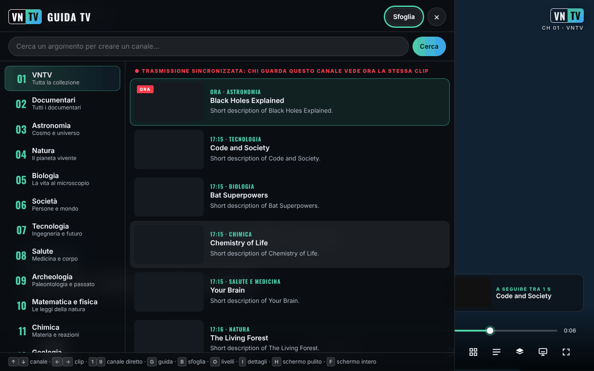

# VNTV — VideoNeat Television

[English](README.md) · [Română](README.ro.md) · [Français](README.fr.md) · **Italiano** · [Español](README.es.md) · [Português](README.pt.md) · [Deutsch](README.de.md) · [Magyar](README.hu.md)

**Versione:** 2.5.3 · **Ultimo aggiornamento:** 2026-10-22

Lingue dell'interfaccia: **Română, English, Français, Italiano, Español, Português (PT), Deutsch, Magyar**

**Online / demo:** https://chiuta.github.io/VNTV/



*La schermata è stata realizzata con dati di prova simulati (titoli fittizi, clip di prova), non con il catalogo reale.*

Un canale TV scientifico non-stop e trade-free (libero da logiche commerciali), costruito a partire dalla collezione di [VideoNeat.com](https://www.videoneat.com):
canali sincronizzati, guida TV, catalogo sfogliabile, sottotitoli tradotti, 8 lingue, e funziona su telefoni,
tablet, computer e televisori. Nessun account, nessuna analytics, nessun cookie; per impostazione predefinita l'app comunica solo con i siti propri di TROM (videoneat.com e videos.trom.tf), vedi *Privacy e trade-free* più sotto.

## Che cos'è

VNTV riproduce i **trailer** dei documentari della collezione VideoNeat (ospitati dall'istanza PeerTube di TROM, `videos.trom.tf`) come un canale televisivo: canali per categoria, guida TV, navigazione nel catalogo, sottotitoli e 8 lingue di interfaccia. Il progetto non ospita video; mostra e rimanda alla fonte ufficiale. Sul canale TROM e sui canali PeerTube che aggiungi tu vengono riprodotti i video completi.

## Contenuto di questo repository

| Cartella | Che cos'è |
|---|---|
| `index.html`, `dist/vntv.html` | **L'app in un unico file.** Aprilo in un browser. Funziona anche dalla cartella Download di un telefono. |
| `deploy/site/` | L'app da ospitare su HTTPS: installabile (schermata Home / app), funziona offline, icone, service worker. |
| `wp-plugin/videoneat-index/` | **Plugin WordPress per videoneat.com**: pubblica il catalogo JSON ufficiale usato da VNTV e dall'addon. |
| `stremio-addon/` | Addon Stremio (7 lingue, catalogo ufficiale, canali PeerTube aggiuntivi, LibreTranslate facoltativo). |
| `src/`, `i18n/` | Sorgenti. `node build.mjs` produce entrambe le varianti dell'app. |
| `tools/` | `coverage.mjs` (quanti titoli sono riproducibili), `structure-check.mjs` (verifica settimanale), `make-icons.py`. |
| `tests/` | Test automatici (Playwright, simulazioni offline). `npm test`. |
| `docs/` | Architettura, pubblicazione, guida per gli amministratori TROM, lettera di proposta a TROM, lista di controllo su dispositivi reali, Android TV. |

**Documentazione:** [Pubblicazione](docs/DEPLOY.it.md) · [Android TV](docs/ANDROID-TV.it.md) · [Guida per gli amministratori TROM](docs/TROM-ADMIN.md) (in inglese) · [Architettura](docs/ARCHITECTURE.md) (in inglese)

## Funzioni

Verificate nel codice:

- 14 canali per categoria, più i **Preferiti** e il canale **TROM**; puoi aggiungere canali PeerTube (Impostazioni → Fonti).
- **Trasmissione sincronizzata** (ON AIR): il palinsesto è calcolato a partire dalla data, quindi tutti gli spettatori dello stesso canale vedono lo stesso clip nello stesso momento (richiede il catalogo JSON con le durate; senza di esso l'app mostra «NON-STOP», una propria playlist).
- Guida TV, navigazione nella collezione con ricerca, scheda dei dettagli, preferiti, ricerca come «canale».
- Sottotitoli PeerTube (comprese le trascrizioni automatiche), traduzione automatica di titoli, descrizioni e sottotitoli.
- 8 lingue: inglese, rumeno, francese, spagnolo, tedesco, italiano, portoghese, ungherese.
- Livelli di visualizzazione (logo, orologio, banner, barra di avanzamento, schermo «retro», ecc.) e 4 preset: TV, Cinema, Retro, Pulito.
- Riproduzione **P2P** (il lettore PeerTube) o **diretta** (file MP4); picture-in-picture, invio al televisore, schermo sempre acceso, comandi dalla schermata di blocco.
- Modalità chiosco per schermi pubblici: `?kiosk=1&ch=3&lang=en&preset=cinema&muted=0&reload=24`.
- La versione ospitata può essere installata come app e funziona offline per l'interfaccia (ma non per i video).

## Manuale d'uso

1. Apri la pagina e premi il pulsante di avvio nella schermata iniziale (oppure Invio/Spazio).
2. Cambia canale con ↑ / ↓ (o le cifre 1–9); clip successivo / precedente con → / ←; Spazio o K mette in pausa.
3. Premi **G** per la guida TV (canali e programma successivo), **B** per sfogliare la collezione, **I** per i dettagli del clip corrente, **O** per livelli e impostazioni, **S** per i preferiti, **F** per lo schermo intero, **H** per lo schermo pulito, **M** per l'audio.
4. Su telefono usi i pulsanti sullo schermo; tocca lo schermo per mostrare i controlli.
5. Per un'altra lingua: Impostazioni (O) → Lingua. La traduzione automatica si può disattivare dallo stesso punto.
6. Per un canale PeerTube: Impostazioni (O) → Mostra tutto → Fonti → incolla l'indirizzo del canale (`https://istanza/c/canale`) → Aggiungi.
7. Se il P2P non funziona o non vuoi che il tuo indirizzo IP sia visibile agli altri spettatori: Impostazioni → Rete → **Diretta**.

## Da dove VNTV prende i dati

1. **Catalogo ufficiale (preferito):** `https://www.videoneat.com/wp-json/videoneat/v1/index`, pubblicato dal
   plugin `videoneat-index`. Un unico piccolo file in cache: veloce, senza analisi fragile, e riporta le durate dei trailer,
   di cui ha bisogno la **trasmissione sincronizzata**.
2. **Riserva:** l'API pubblica di WordPress, leggendo ogni articolo. Più lento; l'app mostra onestamente **NON-STOP**
   invece di **ON AIR**, perché ciascuno riceve la propria playlist.
3. **Fonti aggiuntive:** qualsiasi canale PeerTube con video a licenza aperta può essere aggiunto come canale (Livelli → Fonti).

## Riproduzione

* **P2P** (predefinita su computer e televisori): il lettore PeerTube ufficiale, che distribuisce il carico tra gli spettatori e
  riduce i costi del server di TROM. VNTV lo controlla tramite l'API di incorporamento di PeerTube.
* **Diretta** (predefinita su iOS e sui telefoni che usano i dati mobili): il file MP4 in un elemento `<video>` — necessaria per
  il picture-in-picture, AirPlay e Chromecast, e più leggera per i dati mobili.
* Prima del primo utilizzo del P2P, VNTV spiega che il P2P rende visibile l'IP dello spettatore agli altri spettatori e offre
  invece la riproduzione diretta. Se il lettore PeerTube non risponde entro 10 s, VNTV passa alla riproduzione diretta.

## Canali

Categorie VideoNeat 1–14 (trailer) · 15 Preferiti · **16 TROM** (i documentari completi di TROM da videos.trom.tf)
· 17+ qualsiasi canale PeerTube aggiunto dallo spettatore. Il canale 16 può essere rimosso da Impostazioni → Fonti.

## Privacy e trade-free

* **Archiviazione locale (`localStorage`, solo nel tuo browser):** `vntv.prefs` (lingua, canale, impostazioni), `vntv.ov` (livelli), `vntv.favs` (preferiti), `vntv.trc` (memoria delle traduzioni, max. 2500). Nessun cookie, account o analytics. Se `localStorage` non è disponibile, l'app funziona con memoria temporanea. In modalità chiosco le impostazioni non vengono salvate.
* Host contattati per impostazione predefinita: `www.videoneat.com` (catalogo, immagini; come riserva, l'API WordPress) e `videos.trom.tf` (dati video, file, lettore P2P, sottotitoli). Altri host solo quando lo spettatore aggiunge un canale PeerTube, inserisce un indirizzo LibreTranslate o seleziona esplicitamente MyMemory. In modalità P2P il lettore PeerTube si connette anche ad altri spettatori (WebRTC). Quando l'app è servita da un host come GitHub Pages, quell'host vede la visita come per qualsiasi pagina web.
* I font sono incorporati (Oswald, SIL OFL). Niente Google Fonts, niente analytics, niente cookie.
* Traduzione dei contenuti: il traduttore del browser sul dispositivo, oppure il tuo **LibreTranslate**. Il servizio commerciale
  MyMemory (`api.mymemory.translated.net`) viene usato **solo se lo spettatore lo seleziona esplicitamente**, con un avviso (i testi da tradurre gli vengono inviati).
* Preferiti, impostazioni e traduzioni restano nel browser dello spettatore.
* **Permessi:** schermo sempre acceso (wake lock), schermo intero, picture-in-picture. Non richiede fotocamera, microfono né posizione.
* La pagina contiene una policy CSP (`<meta>`) che limita i caricamenti a HTTPS/HTTP e blocca oggetti e moduli.

## Limiti e avvertenze

- L'app dipende dalla disponibilità di `videoneat.com` e `videos.trom.tf`; senza di essi non ha nulla da riprodurre.
- I trailer appartengono ai produttori (PBS, BBC e altri) e sono mostrati a scopo di scoperta, con un link alla fonte ufficiale. Per la rimozione di contenuti: [TROM](https://www.tromsite.com/contact/); ciò che scompare da VideoNeat / videos.trom.tf scompare anche da VNTV. VNTV non mostra né rimanda a file torrent/magnet.
- Le traduzioni automatiche possono essere sbagliate; puoi sempre vedere l'originale.
- Le schermate e i test automatici usano dati simulati; il funzionamento su dispositivi reali (TV, iOS, Cast) va verificato secondo `docs/TESTING.md`.
- La disponibilità di P2P, AirPlay e Cast varia tra browser e dispositivi.

## Changelog (2.3.0)

* 2.5.3 — 2026-10-22: l'etichetta di trasparenza non elenca più un host corrotto (`${it._h`); l'`index.html` nella radice è ora la versione ospitata con un vero `sw.js`, manifest e icone (l'offline funziona sulla pagina pubblicata); etichette per i due campi di ricerca; focus da tastiera visibile su tutti i controlli; testo ≥ 12 px, link del piè di pagina più grandi e barra dei comandi senza overflow a 360 px; la conferma di apertura di un link usa la finestra nella pagina; se il catalogo non si carica, il messaggio indica ogni fonte che ha fallito (l'indice ufficiale risponde 404/CORS su videoneat.com).
* 2.5.2 — 2026-10-22: il messaggio « impossibile caricare l'elenco » nella schermata iniziale e la descrizione del pannello di trasparenza fff-kit seguono ora la lingua dell'interfaccia quando la si cambia.

* 2.3.0 — 2026-10-18: resilienza agli errori di riproduzione — nuovo tentativo, ripiego su qualità/formato, P2P e host PeerTube alternativo, attesa offline, lista nera locale di 24 h, barra degli errori con azioni, registro errori locale esportabile (senza telemetria).

* 2.2.0 — 2026-10-18: nuovo pannello **Schermo** — Cast / AirPlay, picture-in-picture, finestra separata (secondo monitor) e un link chiosco + codice QR per un televisore o qualsiasi altro schermo.

* 2.1.4 — 2026-10-12: la versione e la data dell'ultimo aggiornamento sono ora mostrate nell'app (pannello Livelli).
* Schermata iniziale: il messaggio «impossibile caricare l'elenco» è ora mostrato in linea sotto il testo introduttivo invece di una notifica che si sovrapponeva al logo VNTV a 360 px; finché il browser segnala di essere offline, la richiesta del catalogo non viene più tentata all'avvio (riprova da sola all'evento `online`).

* CSP: lo script inline è ora consentito tramite hash SHA-256 (calcolato da `build.mjs` a ogni build); `script-src` non contiene più `'unsafe-inline'`.
* La schermata iniziale mostra una nota (7 lingue) quando il browser segnala di essere offline, poiché VNTV non ha contenuti offline.
* La suite di test inclusa (Playwright, rete simulata) ora gira in questo ambiente: 25/25 superati all'esecuzione finale (alla prima esecuzione un test sensibile ai tempi, la sincronizzazione tra due spettatori, era fallito e alla ripetizione è passato).
* L'attributo `allow` dell'iframe PeerTube viene impostato solo quando l'iframe è usato (elimina tre avvisi in console all'avvio).

* L'app è ora racchiusa in un riferimento `<main>` e il titolo «lower third» non è più un titolo vuoto (axe-core: 0 violazioni a 1280 e 360 px).
* Il messaggio «impossibile caricare l'elenco» dice ora chiaramente che VNTV non ha contenuti offline e richiede una connessione a internet (7 lingue).
* Versione portata a 2.1.1 (package.json, lockfile, service worker generato).
* Senza una rete reale il catalogo manca; la riproduzione è stata verificata solo con la rete simulata dei test, non con videoneat.com (limite dichiarato).

## Licenza

MIT, vedi [LICENSE](LICENSE). Font incorporato: Oswald, SIL OFL 1.1 (`src/fonts/OFL-Oswald.txt`, dettagli in [NOTICE.md](NOTICE.md)).

## Compilazione e test

```bash
node build.mjs                 # index.html + dist/vntv.html + deploy/site/index.html + sw.js
npm install                    # ESLint + Playwright (dev only)
npx playwright install chromium
npm run test:all               # lint + 25 end-to-end + 30 PHP + 33 addon tests, all offline
```

Apri `index.html` direttamente nel browser (serve internet per il catalogo e i video). `node build.mjs` genera `index.html`, `dist/vntv.html` e `deploy/site/` e non richiede `npm install`. Per i test completi: `npm install`, `npm run test:all` (Playwright, PHP e Node; tutti girano con dati simulati).

Pubblicazione su GitHub Pages: `Settings → Pages → Source: GitHub Actions`; il workflow `.github/workflows/pages.yml` compila e pubblica `deploy/site` (più `vntv.html` come download).

## Chiosco / schermi pubblici

`vntv.html?kiosk=1&ch=3&lang=en&preset=cinema&muted=0&reload=24` — parte da sola, senza controlli, senza cursore,
si ricarica ogni giorno. Premi **K** tre volte per uscire.

## Autore

Alexio — Alexandru-Ionuț Chiuță, contatto: alexio@trom.tf

---
Vedi [CHANGELOG.md](CHANGELOG.md).
