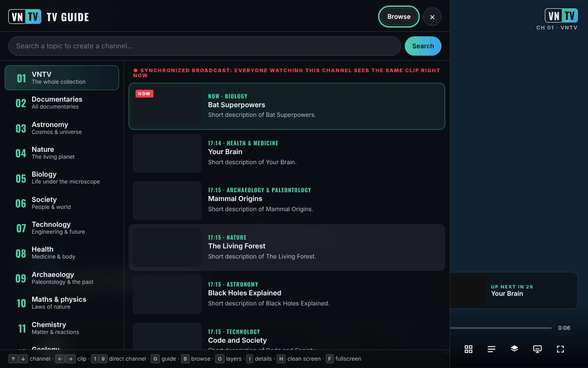

# VNTV — VideoNeat Television

**English** · [Română](README.ro.md) · [Français](README.fr.md) · [Italiano](README.it.md) · [Español](README.es.md) · [Português](README.pt.md) · [Deutsch](README.de.md) · [Magyar](README.hu.md)

**Version:** 2.5.1 · **Last updated:** 2026-10-19

Interface languages: **Română, English, Français, Italiano, Español, Português (PT), Deutsch, Magyar**

**Live / demo:** https://chiuta.github.io/VNTV/



*The screenshot was taken with simulated test data (fictitious titles, a sample clip), not with the real catalogue.*

A non-stop, trade-free science TV channel built from the [VideoNeat.com](https://www.videoneat.com) collection:
synchronized channels, a TV guide, a browsable catalog, translated subtitles, 8 languages, and it works on phones,
tablets, computers and TVs. No accounts, no analytics, no cookies; by default the app talks only to TROM's own sites (videoneat.com and videos.trom.tf), see *Privacy and trade-free* below.

## What it is

VNTV plays the **trailers** of the documentaries in the VideoNeat collection (hosted by TROM's PeerTube instance, `videos.trom.tf`) like a television channel: channels by category, a TV guide, catalog browsing, subtitles and 8 interface languages. The project does not host video; it shows and points to the official source. Full videos play on the TROM channel and on the PeerTube channels you add yourself.

## What's in this repository

| Folder | What it is |
|---|---|
| `index.html`, `dist/vntv.html` | **The app as one file.** Open it in a browser. Works from a phone's Downloads folder too. |
| `deploy/site/` | The app for hosting on HTTPS: installable (home screen / app), works offline, icons, service worker. |
| `wp-plugin/videoneat-index/` | **WordPress plugin for videoneat.com**: publishes the official JSON catalog VNTV and the addon use. |
| `stremio-addon/` | Stremio addon (7 languages, official catalog, extra PeerTube channels, optional LibreTranslate). |
| `src/`, `i18n/` | Sources. `node build.mjs` produces both app variants. |
| `tools/` | `coverage.mjs` (how many titles are playable), `structure-check.mjs` (weekly check), `make-icons.py`. |
| `tests/` | Automated tests (Playwright, offline mocks). `npm test`. |
| `docs/` | Architecture, deployment, TROM admin guide, proposal letter to TROM, real-device checklist, Android TV. |

**Documentation:** [Deployment](docs/DEPLOY.en.md) · [Android TV](docs/ANDROID-TV.en.md) · [TROM admin guide](docs/TROM-ADMIN.md) · [Architecture](docs/ARCHITECTURE.md)

## Features

Verified in the code:

- 14 channels by category, plus **Favorites** and the **TROM** channel; you can add PeerTube channels (Settings → Sources).
- **Synchronized broadcast** (ON AIR): the schedule is computed from the date, so all viewers of the same channel see the same clip at the same moment (it needs the JSON catalog with durations; without it the app shows "NON-STOP", its own playlist).
- TV guide, browsing the collection with search, a detail sheet, favorites, search as a "channel".
- PeerTube subtitles (including automatic transcripts), automatic translation of titles, descriptions and subtitles.
- 8 languages: English, Romanian, French, Spanish, German, Italian, Portuguese, Hungarian.
- Display layers (logo, clock, banner, progress bar, "retro" screen, etc.) and 4 presets: TV, Cinema, Retro, Clean.
- **P2P** playback (the PeerTube player) or **direct** playback (MP4 file); picture-in-picture, casting to a TV, screen kept awake, lock-screen controls.
- Kiosk mode for public screens: `?kiosk=1&ch=3&lang=en&preset=cinema&muted=0&reload=24`.
- The hosted version can be installed as an app and works offline for the interface (but not for video).

## User guide

1. Open the page and press the start button on the start screen (or Enter/Space).
2. Change the channel with ↑ / ↓ (or the digits 1–9); next / previous clip with → / ←; Space or K pauses.
3. Press **G** for the TV guide (channels and the next programme), **B** to browse the collection, **I** for the details of the current clip, **O** for layers and settings, **S** for favorites, **F** for full screen, **H** for a clean screen, **M** for sound.
4. On a phone you use the on-screen buttons; touch the screen to show the controls.
5. For another language: Settings (O) → Language. Automatic translation can be turned off from the same place.
6. For a PeerTube channel: Settings (O) → Show all → Sources → paste the channel address (`https://instance/c/channel`) → Add.
7. If P2P does not work or you do not want your IP address to be visible to other viewers: Settings → Network → **Direct**.

## How VNTV gets its data

1. **Official catalog (preferred):** `https://www.videoneat.com/wp-json/videoneat/v1/index`, published by the
   `videoneat-index` plugin. One small cached file: fast, no fragile parsing, and it carries trailer durations,
   which the **synchronized broadcast** needs.
2. **Fallback:** the public WordPress API, reading each article. Slower; the app honestly shows **NON-STOP**
   instead of **ON AIR** because everyone gets their own playlist.
3. **Extra sources:** any PeerTube channel with openly licensed videos can be added as a channel (Layers → Sources).

## Playback

* **P2P** (default on computers and TVs): the official PeerTube player, which shares the load between viewers and
  lowers TROM's server costs. VNTV controls it through the PeerTube embed API.
* **Direct** (default on iOS and on phones using mobile data): the MP4 file in a `<video>` element — needed for
  picture-in-picture, AirPlay and Chromecast, and lighter on mobile data.
* Before P2P is used the first time, VNTV explains that P2P makes the viewer's IP visible to other viewers and offers
  direct playback instead. If the PeerTube player doesn't respond within 10 s, VNTV switches to direct playback.

## Channels

1–14 VideoNeat categories (trailers) · 15 Favorites · **16 TROM** (TROM's own full documentaries from videos.trom.tf)
· 17+ any PeerTube channel the viewer adds. Channel 16 can be removed in Settings → Sources.

## Privacy and trade-free

* **Local storage (`localStorage`, only in your browser):** `vntv.prefs` (language, channel, settings), `vntv.ov` (layers), `vntv.favs` (favorites), `vntv.trc` (translation memory, max. 2500). No cookies, accounts or analytics. If `localStorage` is unavailable, the app works with temporary memory. In kiosk mode the settings are not saved.
* Hosts contacted by default: `www.videoneat.com` (catalog, images; as a fallback, the WordPress API) and `videos.trom.tf` (video data, files, P2P player, subtitles). Other hosts only when the viewer adds a PeerTube channel, enters a LibreTranslate address, or explicitly selects MyMemory. In P2P mode the PeerTube player also connects to other viewers (WebRTC). When the app is served from a host such as GitHub Pages, that host sees the visit as with any web page.
* Fonts are embedded (Oswald, SIL OFL). No Google Fonts, no analytics, no cookies.
* Translation of content: the browser's on-device translator, or your own **LibreTranslate**. The commercial
  MyMemory service (`api.mymemory.translated.net`) is used **only if the viewer explicitly selects it**, with a warning (the texts being translated are sent to it).
* Favorites, settings and translations stay in the viewer's browser.
* **Permissions:** wake lock (screen kept on), full screen, picture-in-picture. It does not ask for camera, microphone or location.
* The page contains a CSP policy (`<meta>`) that limits loading to HTTPS/HTTP and blocks objects and forms.

## Limits and warnings

- The app depends on the availability of `videoneat.com` and `videos.trom.tf`; without them it has nothing to play.
- The trailers belong to their producers (PBS, BBC and others) and are shown for discovery, with a link to the official source. For content removal: [TROM](https://www.tromsite.com/contact/); whatever disappears from VideoNeat / videos.trom.tf also disappears from VNTV. VNTV does not show or link to torrent/magnet files.
- Automatic translations can be wrong; you can always see the original.
- The screenshots and the automated tests use simulated data; operation on real devices (TV, iOS, Cast) must be verified according to `docs/TESTING.md`.
- The availability of P2P, AirPlay and Cast differs between browsers and devices.

## Changelog (2.3.0)

* 2.3.0 — 2026-10-18: playback-error resilience — retry, quality/format fallback, P2P and alternate PeerTube host, offline wait, 24 h local blacklist, error bar with actions, local exportable error log (no telemetry).

* 2.2.0 — 2026-10-18: new **Screen** panel — Cast / AirPlay, picture-in-picture, separate window (second monitor) and a kiosk link + QR code for a TV or any other screen.

* 2.1.4 — 2026-10-12: the version and the last-updated date are now shown in the app (Layers panel).
* Start screen: the "can't load the list" message is now shown inline under the intro text instead of a toast that overlapped the VNTV logo at 360 px; while the browser reports it is offline, the catalogue request is no longer attempted at start-up (it retries by itself on the `online` event).

* CSP: the inline script is now allowed by SHA-256 hash (computed by `build.mjs` on every build); `script-src` no longer contains `'unsafe-inline'`.
* The start screen shows a notice (7 languages) when the browser reports it is offline, since VNTV has no offline content.
* The bundled test suite (Playwright, mocked network) now runs in this environment: 25/25 passed on the final run (a first run had one failure in the timing-sensitive two-viewer sync test, which passed on re-run).
* The PeerTube iframe's `allow` attribute is set only when the iframe is used (removes three console warnings at start-up).

* The app is now wrapped in a `<main>` landmark and the lower-third title is no longer an empty heading (axe-core: 0 violations at 1280 and 360 px).
* The "can't load the list" message now says plainly that VNTV has no offline content and needs an internet connection (7 languages).
* Version bumped to 2.1.1 (package.json, lockfile, generated service worker).
* Without a real network the catalogue is missing; playback was verified only with the simulated network of the tests, not with videoneat.com (a declared limit).

## Licence

MIT, see [LICENSE](LICENSE). Embedded font: Oswald, SIL OFL 1.1 (`src/fonts/OFL-Oswald.txt`, details in [NOTICE.md](NOTICE.md)).

## Build and test

```bash
node build.mjs                 # index.html + dist/vntv.html + deploy/site/index.html + sw.js
npm install                    # ESLint + Playwright (dev only)
npx playwright install chromium
npm run test:all               # lint + 25 end-to-end + 30 PHP + 33 addon tests, all offline
```

Open `index.html` directly in the browser (internet is needed for the catalog and video). `node build.mjs` generates `index.html`, `dist/vntv.html` and `deploy/site/` and does not require `npm install`. For the full tests: `npm install`, `npm run test:all` (Playwright, PHP and Node; all run with simulated data).

Publishing on GitHub Pages: `Settings → Pages → Source: GitHub Actions`; the workflow `.github/workflows/pages.yml` builds and publishes `deploy/site` (plus `vntv.html` as a download).

## Kiosk / public screens

`vntv.html?kiosk=1&ch=3&lang=en&preset=cinema&muted=0&reload=24` — starts by itself, no controls, no cursor,
reloads daily. Press **K** three times to exit.

## Author

Alexio — Alexandru-Ionuț Chiuță, contact: alexio@trom.tf

---
See [CHANGELOG.md](CHANGELOG.md).
