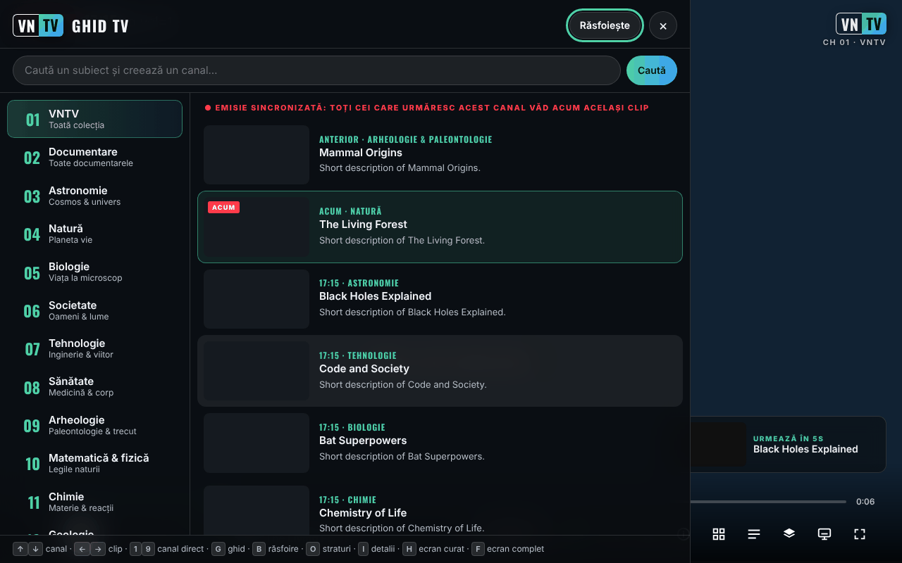

# VNTV — VideoNeat Television

[English](README.md) · **Română** · [Français](README.fr.md) · [Italiano](README.it.md) · [Español](README.es.md) · [Português](README.pt.md) · [Deutsch](README.de.md) · [Magyar](README.hu.md)

**Versiune:** 2.5.7 · **Ultima actualizare:** 2026-10-23

Limbile interfeței: **Română, English, Français, Italiano, Español, Português (PT), Deutsch, Magyar**

Canal TV de știință non-stop, fără urmărire, construit din colecția [VideoNeat.com](https://www.videoneat.com): aplicație web (un singur fișier HTML), plugin WordPress pentru catalog și addon Stremio.

**Live:** https://chiuta.github.io/VNTV/



*Captura a fost făcută cu date de test simulate (titluri fictive, clip de probă), nu cu catalogul real.*

English: see [README.md](README.md).

## Ce este

VNTV redă **trailerele** documentarelor din colecția VideoNeat (găzduite de instanța PeerTube a TROM, `videos.trom.tf`) ca pe un canal de televiziune: canale pe categorii, ghid TV, răsfoirea catalogului, subtitrări și 8 limbi de interfață. Proiectul nu găzduiește video; arată și trimite spre sursa oficială. Pe canalul TROM și pe canalele PeerTube adăugate de tine rulează videoclipuri complete.

Depozitul conține trei componente:

| Componentă | Ce este |
|---|---|
| `index.html` (= `dist/vntv.html`), `deploy/site/` | Aplicația: un singur fișier, respectiv varianta găzduită pe HTTPS (instalabilă, cu `sw.js` pentru lucru offline) |
| `wp-plugin/videoneat-index/` | Plugin WordPress care publică catalogul JSON folosit de aplicație și de addon |
| `stremio-addon/` | Addon Stremio (Node ≥ 18, fără dependențe) |
| `src/`, `i18n/` | Sursele. `node build.mjs` produce ambele variante ale aplicației. |
| `tools/` | `coverage.mjs` (câte titluri se pot reda), `structure-check.mjs` (verificare săptămânală), `make-icons.py`. |
| `tests/` | Teste automate (Playwright, simulări offline). `npm test`. |
| `docs/` | Arhitectură, publicare, ghid pentru administratorii TROM, scrisoare-propunere către TROM, listă de verificare pe dispozitive reale, Android TV. |

**Documentație:** [Publicare (găzduire)](docs/DEPLOY.md) · [Android TV](docs/ANDROID-TV.md) · [Ghid pentru administratorii TROM](docs/TROM-ADMIN.md) (în engleză) · [Arhitectură](docs/ARCHITECTURE.md) (în engleză)

## Funcții

Verificate în cod:

- 14 canale pe categorii, plus **Favorite** și canalul **TROM**; poți adăuga canale PeerTube (Setări → Surse).
- **Emisie sincronizată** (ON AIR): programul se calculează din dată, deci toți spectatorii aceluiași canal văd același clip în același moment (cere catalogul JSON cu durate; fără el aplicația arată „NON-STOP”, listă proprie).
- Ghid TV, răsfoirea colecției cu căutare, fișă de detalii, favorite, căutare ca „canal”.
- Subtitrări PeerTube (inclusiv transcrieri automate), traducere automată a titlurilor, descrierilor și subtitrărilor.
- 8 limbi: engleză, română, franceză, spaniolă, germană, italiană, portugheză, maghiară.
- Straturi de afișaj (siglă, ceas, banner, bară de progres, ecran „retro” etc.) și 4 presetări: TV, Cinema, Retro, Curat.
- Redare **P2P** (playerul PeerTube) sau **directă** (fișier MP4); imagine în imagine, trimitere pe TV, ecran aprins, controale de pe ecranul de blocare.
- Mod chioșc pentru ecrane publice: `?kiosk=1&ch=3&lang=ro&preset=cinema&muted=0&reload=24`.
- Varianta găzduită se poate instala ca aplicație și merge offline pentru interfață (nu și pentru video).

## Manual de utilizare

1. Deschide pagina și apasă butonul de pornire de pe ecranul de start (sau Enter/Spațiu).
2. Schimbă canalul cu ↑ / ↓ (sau cifrele 1–9); clipul următor / precedent cu → / ←; Spațiu sau K pune pauză.
3. Apasă **G** pentru ghidul TV (canale și programul următor), **B** pentru răsfoirea colecției, **I** pentru detaliile clipului curent, **O** pentru straturi și setări, **S** pentru favorite, **F** pentru ecran complet, **H** pentru ecran curat, **M** pentru sunet.
4. Pe telefon folosești butoanele de pe ecran; atinge ecranul pentru a arăta controalele.
5. Pentru altă limbă: Setări (O) → Limbă. Traducerea automată se poate opri din același loc.
6. Pentru un canal PeerTube: Setări (O) → Arată tot → Surse → lipește adresa canalului (`https://instanță/c/canal`) → Adaugă.
7. Dacă P2P nu merge sau nu vrei ca adresa ta IP să fie vizibilă altor spectatori: Setări → Rețea → **Direct**.

## Cum își ia VNTV datele

1. **Catalog oficial (preferat):** `https://www.videoneat.com/wp-json/videoneat/v1/index`, publicat de pluginul `videoneat-index`. Un singur fișier mic, în cache: rapid, fără parsare fragilă, și poartă duratele trailerelor, de care are nevoie **emisia sincronizată**.
2. **Rezervă:** API-ul public WordPress, citind fiecare articol. Mai lent; aplicația arată sincer **NON-STOP** în loc de **ON AIR**, fiindcă fiecare primește propria listă de redare.
3. **Surse suplimentare:** orice canal PeerTube cu videoclipuri cu licență deschisă poate fi adăugat cacanal (Straturi → Surse).

## Redare

* **P2P** (implicit pe computere și televizoare): playerul oficial PeerTube, care împarte sarcina între spectatori și reduce costurile serverului TROM. VNTV îl controlează prin API-ul de încorporare PeerTube.
* **Directă** (implicit pe iOS și pe telefoane cu date mobile): fișierul MP4 într-un element `<video>` — necesar pentru imagine în imagine, AirPlay și Chromecast, și mai ușor pentru datele mobile.
* Înainte de prima utilizare a P2P, VNTV explică faptul că P2P face adresa IP a spectatorului vizibilă altor spectatori și oferă redarea directă în loc. Dacă playerul PeerTube nu răspunde în 10 s, VNTV trece la redarea directă.

## Canale

Categoriile VideoNeat 1–14 (trailere) · 15 Favorite · **16 TROM** (documentarele complete ale TROM de pe videos.trom.tf) · 17+ orice canal PeerTube adăugat de spectator. Canalul 16 poate fi eliminat din Setări → Surse.

## Confidențialitate și rețea

- **Stocare locală (`localStorage`, doar în browserul tău):** `vntv.prefs` (limbă, canal, setări), `vntv.ov` (straturi), `vntv.favs` (favorite), `vntv.trc` (memoria traducerilor, max. 2500). Fără cookie-uri, conturi sau analitice. Dacă `localStorage` nu e disponibil, aplicația merge cu memorie temporară. În modul chioșc setările nu se salvează.
- **Gazde contactate implicit:** `www.videoneat.com` (catalogul JSON, imagini; ca rezervă, API-ul WordPress) și `videos.trom.tf` (detalii video, fișiere, subtitrări, playerul PeerTube încorporat). Fonturile sunt încorporate în fișier.
- **În modul P2P**, playerul PeerTube încorporat se conectează și la alți spectatori (WebRTC), deci adresa ta IP le este vizibilă; aplicația te avertizează înainte de prima utilizare și oferă redarea directă.
- **Doar la alegerea ta:** orice instanță PeerTube pe care o adaugi ca sursă; un server LibreTranslate a cărui adresă o introduci; serviciul comercial **MyMemory** (`api.mymemory.translated.net`), doar dacă îl alegi explicit, cu avertisment (textele traduse îi sunt trimise). Traducătorul din browser rulează pe dispozitiv.
- **Hosting:** când pagina e servită de un gazdă (de ex. GitHub Pages), gazda vede vizita ca la orice pagină web.
- **Permisiuni:** ecran aprins (wake lock), ecran complet, imagine în imagine. Nu cere cameră, microfon sau locație.
- Pagina conține o politică CSP (`<meta>`) care limitează încărcările la HTTPS/HTTP și blochează obiecte și formulare.

## Limite și avertismente

- Aplicația depinde de disponibilitatea `videoneat.com` și `videos.trom.tf`; fără ele nu are ce reda.
- Trailerele aparțin producătorilor (PBS, BBC și alții) și sunt arătate pentru descoperire, cu link spre sursa oficială. Pentru retragere de conținut: [TROM](https://www.tromsite.com/contact/); ce dispare de pe VideoNeat / videos.trom.tf dispare și din VNTV. VNTV nu arată și nu trimite spre fișiere torrent/magnet.
- Traducerile automate pot greși; poți vedea oricând originalul.
- Capturile de ecran și testele automate folosesc date simulate; funcționarea pe dispozitive reale (TV, iOS, Cast) trebuie verificată conform `docs/TESTING.md`.
- Disponibilitatea P2P, AirPlay și Cast diferă între browsere și dispozitive.

## Rulare locală / offline

```bash
node build.mjs          # generează index.html, dist/vntv.html și deploy/site/ (nu cere npm install)
```

Deschide `index.html` direct în browser (necesită internet pentru catalog și video). Pentru testele complete: `npm install`, `npm run test:all` (Playwright, PHP și Node; toate rulează cu date simulate).

```bash
node build.mjs                 # index.html + dist/vntv.html + deploy/site/index.html + sw.js
npm install                    # ESLint + Playwright (doar pentru dezvoltare)
npx playwright install chromium
npm run test:all               # lint + 25 end-to-end + 30 PHP + 33 teste addon, toate offline
```

Publicare pe GitHub Pages: `Settings → Pages → Source: GitHub Actions`; workflow-ul `.github/workflows/pages.yml` construiește și publică `deploy/site` (plus `vntv.html` ca descărcare).

## Istoric / Changelog (2.3.0)

### 2.5.6 — 2026-10-22
- Teste: așteptări pe condiții în loc de timp real, deci suitele trec stabil sub încărcare. Comportamentul aplicației nu se schimbă.

### 2.5.5 — 2026-10-22
- fff-kit 1.1.4: ținte tactile și text minim; ținte tactile/text corectate

* 2.5.4 — 2026-10-22: fff-kit 1.1.2: PBKDF2 600 000 de iterații, protecție anti-clickjacking.
* 2.5.3 — 2026-10-22: eticheta de transparență nu mai listează o gazdă coruptă (`${it._h`); `index.html` din rădăcină este acum varianta găzduită, cu `sw.js`, manifest și pictograme reale (offline funcționează pe pagina publicată); etichete pentru cele două câmpuri de căutare; focus de tastatură vizibil pe toate controalele; text ≥ 12 px, linkuri din subsol mai mari și bara de comenzi fără depășire la 360 px; confirmarea deschiderii unui link folosește dialogul din pagină; când catalogul nu se poate încărca, mesajul numește fiecare sursă care a eșuat (indexul oficial răspunde 404/CORS pe videoneat.com).
* 2.5.2 — 2026-10-22: mesajul „nu pot încărca lista” de pe ecranul de start și descrierea din panoul de transparență fff-kit urmează acum limba interfeței când aceasta se schimbă.

* 2.3.0 — 2026-10-18: reziliență la erori de redare — reîncercare, alt format/calitate, P2P și altă instanță PeerTube, așteptare offline, listă neagră locală 24 h, bară de erori cu acțiuni, jurnal local exportabil (fără telemetrie).

* 2.2.0 — 2026-10-18: panou nou **Ecran** — Cast / AirPlay, imagine în imagine, fereastră separată (al doilea monitor) și link de chioșc + cod QR pentru TV sau alt ecran.

- 2.1.4 — 2026-10-12: versiunea și data ultimei actualizări sunt afișate în aplicație (panoul Straturi)
- Ecranul de start: mesajul „nu pot încărca lista” apare în pagină, sub text, și nu mai este o notificare suprapusă peste sigla VNTV pe ecrane de 360 px; cât timp browserul raportează că este offline, cererea către catalog nu se mai încearcă la pornire (reîncearcă singură la evenimentul `online`).

- CSP: scriptul inline este permis prin hash SHA-256 (calculat de `build.mjs` la fiecare build); `script-src` nu mai conține `'unsafe-inline'`.
- Ecranul de start afișează o notă (7 limbi) când browserul raportează că este offline, fiindcă VNTV nu are conținut offline.
- Suita proprie de teste (Playwright, rețea simulată) a putut fi rulată în acest mediu: 25/25 reușite la rularea finală (la prima rulare un test, sincronizarea între doi spectatori, sensibil la timp, a eșuat și a trecut la reluare).
- Atributul `allow` al iframe-ului PeerTube se setează doar când iframe-ul e folosit (dispar trei avertismente din consolă la pornire).

- Aplicația este încadrată în `<main>`, iar titlul „lower third” nu mai e un titlu gol (axe-core: 0 violări la 1280 și 360 px).
- Mesajul „Nu pot încărca lista” precizează acum că VNTV nu are conținut offline și cere internet (7 limbi).
- Versiune ridicată la 2.1.1 (package.json, package-lock.json, sw.js generat).
- Fără rețea reală, catalogul lipsește; redarea a fost verificată doar cu rețeaua simulată din teste, nu cu videoneat.com (limită declarată).

## Chioșc / ecrane publice

`vntv.html?kiosk=1&ch=3&lang=en&preset=cinema&muted=0&reload=24` — pornește singură, fără controale, fără cursor, se reîncarcă zilnic. Apasă **K** de trei ori pentru a ieși.

## Licență

MIT, vezi [LICENSE](LICENSE). Fontul încorporat Oswald este sub SIL Open Font License 1.1 (`src/fonts/OFL-Oswald.txt`, detalii în [NOTICE.md](NOTICE.md)).

## Autor

Alexio — Alexandru-Ionuț Chiuță, contact: alexio@trom.tf

## Rezumat

VNTV este un canal TV științific non-stop, fără comerț, construit din colecția de trailere VideoNeat.com: o aplicație web într-un singur fișier (canale „în direct” sincronizate, ghid TV, navigare, subtitrări, 8 limbi), un plugin WordPress care publică catalogul ca JSON și un addon Stremio. Fără conturi, cookie-uri sau analitice; implicit contactează doar videoneat.com și videos.trom.tf (în modul P2P și alți spectatori). Setările și favoritele rămân în localStorage al browserului. Licență MIT.

---
Vezi [CHANGELOG.md](CHANGELOG.md).
