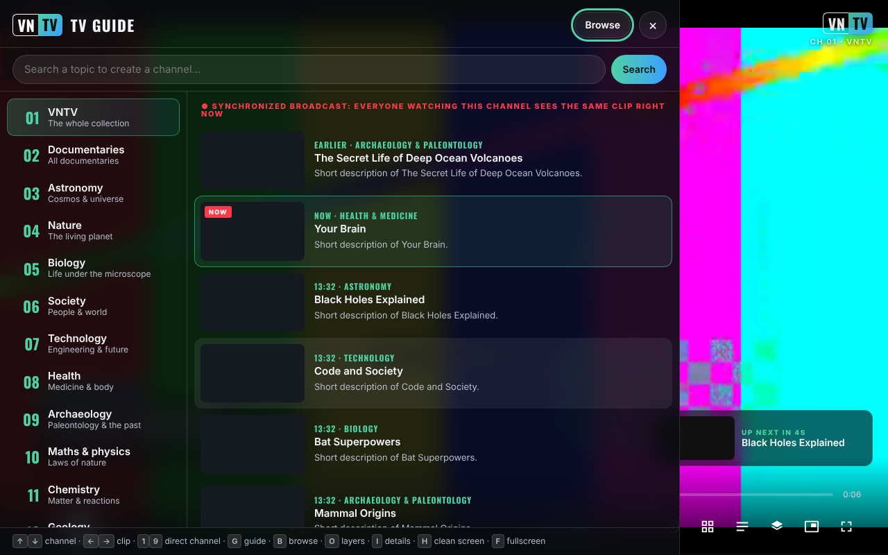

# VNTV — VideoNeat Television

Canal TV de știință non-stop, fără urmărire, construit din colecția [VideoNeat.com](https://www.videoneat.com): aplicație web (un singur fișier HTML), plugin WordPress pentru catalog și addon Stremio.

**Live:** https://chiuta.github.io/VNTV/



*Captura a fost făcută cu date de test simulate (titluri fictive, clip de probă), nu cu catalogul real.*

English: see [README.md](README.md).

## Ce este

VNTV redă **trailerele** documentarelor din colecția VideoNeat (găzduite de instanța PeerTube a TROM, `videos.trom.tf`) ca pe un canal de televiziune: canale pe categorii, ghid TV, răsfoirea catalogului, subtitrări și 7 limbi de interfață. Proiectul nu găzduiește video; arată și trimite spre sursa oficială. Pe canalul TROM și pe canalele PeerTube adăugate de tine rulează videoclipuri complete.

Depozitul conține trei componente:

| Componentă | Ce este |
|---|---|
| `index.html` (= `dist/vntv.html`), `deploy/site/` | Aplicația: un singur fișier, respectiv varianta găzduită pe HTTPS (instalabilă, cu `sw.js` pentru lucru offline) |
| `wp-plugin/videoneat-index/` | Plugin WordPress care publică catalogul JSON folosit de aplicație și de addon |
| `stremio-addon/` | Addon Stremio (Node ≥ 18, fără dependențe) |

## Funcții

Verificate în cod:

- 14 canale pe categorii, plus **Favorite** și canalul **TROM**; poți adăuga canale PeerTube (Setări → Surse).
- **Emisie sincronizată** (ON AIR): programul se calculează din dată, deci toți spectatorii aceluiași canal văd același clip în același moment (cere catalogul JSON cu durate; fără el aplicația arată „NON-STOP”, listă proprie).
- Ghid TV, răsfoirea colecției cu căutare, fișă de detalii, favorite, căutare ca „canal”.
- Subtitrări PeerTube (inclusiv transcrieri automate), traducere automată a titlurilor, descrierilor și subtitrărilor.
- 7 limbi: engleză, română, franceză, spaniolă, germană, italiană, portugheză.
- Straturi de afișaj (siglă, ceas, banner, bară de progres, ecran „retro” etc.) și 4 presetări: TV, Cinema, Retro, Curat.
- Redare **P2P** (playerul PeerTube) sau **directă** (fișier MP4); imagine în imagine, trimitere pe TV, ecran aprins, controale de pe ecranul de blocare.
- Mod chioșc pentru ecrane publice: `?kiosk=1&ch=3&lang=ro&preset=cinema&muted=0&reload=24`.
- Varianta găzduită se poate instala ca aplicație și merge offline pentru interfață (nu și pentru video).

## Manual de utilizare

1. Deschide pagina și apasă butonul de pornire de pe ecranul de start (sau Enter/Spațiu).
2. Schimbă canalul cu ↑ / ↓ (sau cifrele 1–9); clipul următor / precedent cu → / ←; Spațiu sau K pune pauză.
3. Apasă **G** pentru ghidul TV (canale și programul următor), **B** pentru răsfoirea colecției, **I** pentru detaliile clipului curent, **O** pentru straturi și setări, **S** pentru favorite, **F** pentru ecran complet, **H** pentru ecran curat, **M** pentru sunet.
4. Pe telefon folosești butoanele de pe ecran; atinge ecranul pentru a arăta controalele.
5. Pentru altă limbă: Setări (O) → Limbă. Traducerea automată se poate opri din același loc.
6. Pentru un canal PeerTube: Setări (O) → Arată tot → Surse → lipește adresa canalului (`https://instanță/c/canal`) → Adaugă.
7. Dacă P2P nu merge sau nu vrei ca adresa ta IP să fie vizibilă altor spectatori: Setări → Rețea → **Direct**.

## Confidențialitate și rețea

- **Stocare locală (`localStorage`, doar în browserul tău):** `vntv.prefs` (limbă, canal, setări), `vntv.ov` (straturi), `vntv.favs` (favorite), `vntv.trc` (memoria traducerilor, max. 2500). Fără cookie-uri, conturi sau analitice. Dacă `localStorage` nu e disponibil, aplicația merge cu memorie temporară. În modul chioșc setările nu se salvează.
- **Gazde contactate implicit:** `www.videoneat.com` (catalogul JSON, imagini; ca rezervă, API-ul WordPress) și `videos.trom.tf` (detalii video, fișiere, subtitrări, playerul PeerTube încorporat). Fonturile sunt încorporate în fișier.
- **În modul P2P**, playerul PeerTube încorporat se conectează și la alți spectatori (WebRTC), deci adresa ta IP le este vizibilă; aplicația te avertizează înainte de prima utilizare și oferă redarea directă.
- **Doar la alegerea ta:** orice instanță PeerTube pe care o adaugi ca sursă; un server LibreTranslate a cărui adresă o introduci; serviciul comercial **MyMemory** (`api.mymemory.translated.net`), doar dacă îl alegi explicit, cu avertisment (textele traduse îi sunt trimise). Traducătorul din browser rulează pe dispozitiv.
- **Hosting:** când pagina e servită de un gazdă (de ex. GitHub Pages), gazda vede vizita ca la orice pagină web.
- **Permisiuni:** ecran aprins (wake lock), ecran complet, imagine în imagine. Nu cere cameră, microfon sau locație.
- Pagina conține o politică CSP (`<meta>`) care limitează încărcările la HTTPS/HTTP și blochează obiecte și formulare.

## Limite și avertismente

- Aplicația depinde de disponibilitatea `videoneat.com` și `videos.trom.tf`; fără ele nu are ce reda.
- Trailerele aparțin producătorilor (PBS, BBC și alții) și sunt arătate pentru descoperire, cu link spre sursa oficială. Pentru retragere de conținut: [TROM](https://www.tromsite.com/contact/); ce dispare de pe VideoNeat / videos.trom.tf dispare și din VNTV. VNTV nu arată și nu trimite spre fișiere torrent/magnet.
- Traducerile automate pot greși; poți vedea oricând originalul.
- Capturile de ecran și testele automate folosesc date simulate; funcționarea pe dispozitive reale (TV, iOS, Cast) trebuie verificată conform `docs/TESTING.md`.
- Disponibilitatea P2P, AirPlay și Cast diferă între browsere și dispozitive.

## Rulare locală / offline

```bash
node build.mjs          # generează index.html, dist/vntv.html și deploy/site/ (nu cere npm install)
```

Deschide `index.html` direct în browser (necesită internet pentru catalog și video). Pentru testele complete: `npm install`, `npm run test:all` (Playwright, PHP și Node; toate rulează cu date simulate).

Publicare pe GitHub Pages: `Settings → Pages → Source: GitHub Actions`; workflow-ul `.github/workflows/pages.yml` construiește și publică `deploy/site` (plus `vntv.html` ca descărcare).

## Istoric / Changelog (2.1.1)

Ultima actualizare: 11 octombrie 2026 (versiunea 2.1.1).

- Aplicația este încadrată în `<main>`, iar titlul „lower third” nu mai e un titlu gol (axe-core: 0 violări la 1280 și 360 px).
- Mesajul „Nu pot încărca lista” precizează acum că VNTV nu are conținut offline și cere internet (7 limbi).
- Versiune ridicată la 2.1.1 (package.json, package-lock.json, sw.js generat).
- Fără rețea, catalogul lipsește: nu am putut verifica redarea reală în acest mediu (limită declarată).

## Licență

MIT, vezi [LICENSE](LICENSE). Fontul Oswald este sub SIL Open Font License 1.1 (`src/fonts/OFL-Oswald.txt`, detalii în [NOTICE.md](NOTICE.md)).

## Autor

Alexio — Alexandru-Ionuț Chiuță, contact: alexio@trom.tf

## English summary

VNTV is a trade-free, non-stop science TV channel built from the VideoNeat.com trailer collection: a single-file web app (synchronized "on air" channels, TV guide, browsing, subtitles, 7 languages), a WordPress plugin that publishes the catalog as JSON, and a Stremio addon. No accounts, cookies or analytics; by default it contacts only videoneat.com and videos.trom.tf (in P2P mode also other viewers). Settings and favorites stay in the browser's localStorage. MIT licence.
